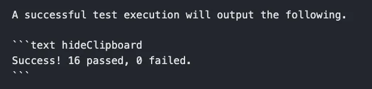

<!-- vale off -->

# Markdown and MDX

## Markdown Links and URLs

Markdown links use path references to link to other documentation pages. The markdown link contains the path to the page
in context from the current file. All references to another documentation page must end with the `.md` extension.

The build process automatically removes the `.md` extension from the URL during the compile. The path helps generate the
correct URL for the page when versioning is enabled.

The following example shows how to reference a page in common scenarios. Assume you have the following folder structure
when reviewing the examples.

```shell
.
└── docs
    └── docs-content
        ├── architecture
        │   ├── grpc.md
        │   └── ip-addresses.md
        ├── aws
        │   └── iam-permissions.md
        ├── clusters
        └── security.md
```

### Same Folder

To link to a file in the same folder, use the following syntax.

```md

```

Because the file is in the same folder, you don't need to specify the path to the file.

The build process automatically searches the current folder for the file when compiling the markdown content.

For example, to reference `ip-addresses.md` from `grpc.md`, use the following syntax.

```md

```

### Different Folder

To link to a file in a different folder, use either a relative path from the current file or an absolute path from the
`docs-content` root.

For example, to reference `iam-permissions.md` from `security.md`, use one of the following paths.

```md title="Relative path"

```

```md title="Absolute path"

```

To reference `iam-permissions.md` from `grpc.md`, use one of the following paths.

```md title="Relative path"

```

```md title="Absolute path"

```

### A Heading in the Same File

To link to a heading in the same file, use the following syntax.

```md
[Link to a heading in the same file](#heading-name)
```

The `#` symbol references a heading in the same file. Use lowercase characters for the heading name, and replace spaces
with a `-` symbol. The default behavior uses dashes to separate words in the URL.

### A Heading in a Different File

To link to a heading in a different file, use the following syntax.

```md
[Link to a heading in a different file](name_of_file.md#heading-name)
```

For example, to reference the `Palette gRPC API` heading in `security.md` from `grpc.md`, use the following syntax.

```md
[Link to a heading in a different file](../security.md#palette-grpc-api)
```

The important thing to remember is that the `#` comes after the file name and before the heading name.

### Linking to and from API Docs

In Docusaurus, a **plugin** is a separate content system that owns its own source files, routes, and sidebar. Each
plugin processes Markdown independently and maintains its own file-path-to-URL mapping.

This repository configures two docs plugins in `docusaurus.config.js`.

| Plugin                 | Source folder                | URL base | Content               |
| ---------------------- | ---------------------------- | -------- | --------------------- |
| Main docs (default)    | `docs/docs-content/`         | `/`      | Product documentation |
| API docs (`id: "api"`) | `docs/api-content/api-docs/` | `/api`   | API reference         |

> [!NOTE] Tutorials and Downloads have their own sidebars in the navbar, but they use the same plugin as the rest of the
> product docs. Their folders live within `docs/docs-content/` and use the same URL base (`/`). The site shows a
> different sidebar depending on which navbar item you select (configured in `sidebars.js` and `docusaurus.config.js`),
> but Docusaurus still processes all of those pages as one plugin. That is why a tutorial can link to a product doc with
> a path such as `../../profiles/profiles.md`, while a link to the API reference must use a URL path such as
> `/api/introduction`.

Path links with a `.md` extension only work **within the same plugin**. You can link from one product doc to another
using the path syntax described above because the main docs plugin processes both files under `docs/docs-content/`.

Docusaurus cannot resolve a `.md` path across plugins. For example, a link from `docs/docs-content/` to
`docs/api-content/api-docs/1-introduction.md` doesn't work, even though both folders live under `docs/`. To link between
plugins, use a **URL path** instead. Don't include a file extension in the link.

```md
<!-- From a page in docs/docs-content/ -->

[Palette API introduction](/api/introduction)

[API Key section](/api/introduction#api-key)

[Palette API v1 endpoints](/api/category/palette-api-v1/)
```

The same rule applies in reverse. From a page under `docs/api-content/`, link back to product docs with a URL path.

```md
<!-- From a page in docs/api-content/ -->

[Create API Key](/user-management/authentication/api-key/create-api-key)
```

Use the route path the page appears at on the site, not the folder path in the repository. For example, use
`/api/introduction`, not `/api-content/api-docs/1-introduction.md` or `/api-content/authentication`.

> [!NOTE] Root-relative URL paths such as `/api/introduction` resolve against the current host. On a legacy deployment
> such as [v4.8.x](https://version-4-8.legacy.docs.spectrocloud.com/), that link stays on the versioned site. Avoid
> hard-coded links to `https://docs.spectrocloud.com/...` in content that must work on archived versions, because those
> always point to the latest production site.

## Redirects

If a file already exists and you need to move it elsewhere, add a redirect entry that points from the old path to the
new path using the [redirects.js](../../redirects.js) file. This ensures that anywhere old links are used, whether that
be links embedded in the product or pages saved by customers, continue to work. Below is an example of what a redirect
entry should look like.

```js
  {
    from: `/clusters/nested-clusters/`,
    to: `/clusters/sandbox-clusters`,
  },
```

## Images or other assets

All images must reside in the [`static/assets/docs/images`](../../static/assets/docs/images/) folder. All images must be
in webp format. If you save png, jpg, or jpeg to the directory, the commit hook will convert the images to webp format.
Alternately, issue the command `make format-images` to convert the images to webp format.

```md

```

You can add a directory to the images folder.

```md

```

**Image Loading** Image size loading can be customized. You can provide eager-load to images in the first fold of the
image with high priority so LCP (Largest Contentful Paint) for the page is not affected.

```md

```

### Diagrams

Architecture diagrams follow their own conventions so that readers who move between pages recognize the same concept
without re-learning what shapes and colors mean. Every new diagram in the docs site is authored as
[Archify](https://github.com/tt-a1i/archify) JSON source and exported to two WEBP images, one for the site's light theme
and one for its dark theme. The JSON source is the source of truth. The WEBP images are the rendered output that ships
with the docs.

Archify also renders an interactive HTML version of each diagram. Use it locally to review the layout and the source
links.

#### When to Add a Diagram

Add a diagram when a mental model is faster to grasp visually than in prose. Good candidates include sequence-of-events
flows, decision trees, entity relationships, and physical topologies. Do not inline a diagram inside a how-to guide.
How-to guides keep to the steps and link to the diagram on its Explanation or Reference page.

#### Write for the Page's Reader

A diagram on a product page is for the people who read that page, the customers who evaluate, install, or use the
product. Draw what they can see and act on, in the words the console and the rest of the docs use.

- Use the product's names for components, not internal service names, code paths, or package names. If the product's own
  terminology changes, the diagram changes with it.

- Leave out port numbers, versions, and other details that change between releases, unless the page is about them.

- Collapse internals the reader never operates into one component. For example, draw one _Control plane_ component
  instead of the controllers and custom resources behind it.

- Show what matters for the reader's decisions, such as what stays on their infrastructure and what can leave it.

#### Diagram Types

Most diagrams in the docs are `architecture` diagrams, which show the components of a system and how they connect.
Archify also renders `sequence`, `workflow`, `dataflow`, `lifecycle`, `erd`, `tree`, `class`, `timeline`, and
`waterfall` diagrams. Each type has its own schema in the Archify `archify/schemas` folder. To find the right type for a
question, run the Archify `guide` command.

```sh
node ~/archify-v3.2.0/archify/bin/archify.mjs guide "<diagram-question>"
```

Replace `<diagram-question>` with a short description of what the diagram must explain.

The conventions in [Color Roles](#color-roles), [Arrow Vocabulary](#arrow-vocabulary), and [Boundaries](#boundaries)
apply to `architecture` diagrams. For other types, follow the type's schema and keep the same component names.

#### Color Roles

Archify gives each component one of seven fixed types, and each type has its own color. You cannot set a custom color,
so pick the type that names the role of the component, not the color that looks best next to its neighbors.

| **Role**                   | **Archify `type`** | **Color** | **When to Use**                                                                      |
| -------------------------- | ------------------ | --------- | ------------------------------------------------------------------------------------ |
| Outside the product        | `external`         | Slate     | Users, administrators, client applications, and anything else outside the product.   |
| Entry and request path     | `frontend`         | Cyan      | Components that handle a live request, such as an ingress, a gateway, or a console.  |
| Local compute              | `backend`          | Green     | Workloads that run on the customer's own hardware, such as inference engines.        |
| External or opt-in service | `cloud`            | Amber     | Third-party services the product can reach, and anything that is off by default.     |
| Control plane and state    | `database`         | Violet    | Components that store configuration or state and apply it to the rest of the system. |
| Identity and access        | `security`         | Rose      | Identity providers, sign-in, and access control.                                     |
| Monitoring                 | `messagebus`       | Orange    | Metrics, logs, traces, and dashboards.                                               |

Name each role in the diagram's legend with `meta.legend.entries.<type>.label`. Use the role name from the table, or the
product's own word for it, such as _Local inference on GPUs_ for the `backend` type.

#### Arrow Vocabulary

Set the `variant` of every connection so that the arrow signals what kind of interaction it is.

| **Variant** | **Color** | **Meaning**                                                                                   |
| ----------- | --------- | --------------------------------------------------------------------------------------------- |
| `emphasis`  | Green     | The main request path. Reserve it for the path the reader cares about most.                   |
| `default`   | Slate     | Any other call, such as an administrator opening the console.                                 |
| `dashed`    | Violet    | A reconcile or deploy loop, a metrics or telemetry hop, or an optional or off-by-default hop. |
| `security`  | Rose      | Sign-in, token checks, and other identity traffic.                                            |

Label a connection only when the label adds information the reader cannot infer from the components. Prefer short verbs
or conditions, such as _deploys_ or _off by default_.

A label has no room for exceptions. When a behavior applies only to some requests, label the connection with what always
holds, such as _off by default_, and explain which requests the behavior covers in the page text.

If Archify's automatic routing makes two connections cross, set `fromSide`, `toSide`, or `route` on one of them. The
`finalize` command in [Regenerate a Diagram](#regenerate-a-diagram) reports crossings and overlapping labels.

#### Boundaries

Wrap the components that run inside the product in a `region` boundary named after the product or the appliance.
Components outside the product, such as users and third-party services, stay outside it. Nest a smaller `region` inside
it for a hardware grouping, such as the components that run on GPUs. Use a `security-group` boundary for a network or
trust boundary.

A boundary's `pad` sets the space between the boundary and the components it wraps. Raise it, for example to `40`, when
a connection has to run along the inside edge of the boundary, so that the connection stays inside it.

#### Label Style

Component labels are short noun phrases. Sub-labels below the component name carry one short detail, such as _admin web
UI_ or _tokens, quotas, cache_. The export script enlarges the text, so keep a label, including any callout number, to
about 21 characters and a sub-label to about 23 characters. Longer text does not fit on one line of a 170-pixel-wide
component, and the script warns when it overflows. Never write a sentence inside a component. A sentence belongs in the
prose next to the diagram.

Keep connection labels to one or two short words where the connection crosses the gap between two columns, because the
enlarged label must fit in that gap. A longer label fits on a connection that runs vertically.

Archify `cards` appear in the interactive HTML but not in the exported image. Put anything you would write in a card in
the page prose instead.

#### Layout

The docs site scales a diagram down to the width of the page column, which is about 700 pixels at desktop size. The
wider the canvas, the smaller its text appears on the page. Keep the canvas to three columns of components, about 800
pixels wide, and grow the diagram downward instead of sideways.

Place components with `pos` on a grid so that rows and columns line up, and give every component the same `size`, such
as `[170, 64]`. Columns at `x` 60, 300, and 540, and rows 140 pixels apart, starting at `y` 40, leave room for
connection labels.

Arrange the three columns so that the diagram reads from top to bottom and from left to right.

- Put the people and clients outside the product in the top row, above the product boundary.

- Run the main request path down the middle column.

- Put the administration side, such as the console, identity provider, and control plane, in the left column.

- Put the destinations of a request, such as local compute and external services, in the right column. External services
  go in the top row, outside the product boundary.

If Archify places a connection label on top of a component, set `labelAt` to an `[x, y]` point in the gap between two
rows.

Keep the diagram to a single canvas. If a diagram feels too dense to fit, split it into two diagrams on separate anchors
rather than shrinking the components. Two clear diagrams are easier to read than one crowded diagram.

#### Numbered Callouts

When the page walks the reader through the diagram, number the components the walkthrough describes, in the order a
request reaches them. Put the number at the start of the component label, such as `"label": "2. Gateway"`, and follow
the diagram with a numbered list in which each item describes the component with the same number. Name the component in
the item's sentence. Do not start the item with a bold label.

Not every component needs a number. Actors outside the product, and components that an item already covers, such as the
identity provider behind the console, can stay unnumbered.

The numbers appear in both the JSON source and the page. Change both in the same commit. Keep the image's alt text
short, describe the overall layout, and point to the list instead of repeating it.

#### Source Evidence

When you have access to the product's source code, cite where each component is defined. Archify checks every citation.
Citations show reviewers where each claim comes from, and they show you what moved when you update the diagram for a new
release.

- Set `meta.repository` to the source repository's HTTPS URL, with `"provider": "github"` and `"link_mode": "web"`.
  Archify rejects SSH URLs.

- Set `meta.repository.revision` to the full commit SHA of the release that the docs version describes, not the tip of
  the default branch.

- Give each component up to three `sources`, each with a `path`, a `line`, an optional `end_line`, and a short `label`.

Citations do not appear in the exported images. They appear as links in the interactive HTML.

For a diagram that cites its sources, refer to the PaletteAI Inference Launchpad architecture diagram source,
[`architecture-overview.architecture.json`](../products/paletteai-inference-launchpad/explanation/archify/architecture-overview.architecture.json).

#### Tooling

The docs repository authors diagrams with [Archify](https://github.com/tt-a1i/archify) v3.2.0, exports them with the
[`scripts/archify-export.mjs`](../../scripts/archify-export.mjs) script, and converts them to WEBP with
[`cwebp`](https://developers.google.com/speed/webp/download).

The JSON source for each diagram lives in an `archify/` subdirectory next to the page it belongs to, named
`<diagram-name>.<diagram-type>.json`. The exported WEBP images land under `static/assets/docs/images/` per the standard
image naming convention, as `<markdown-file-name>_<image-description>.webp` for the light theme and
`<markdown-file-name>_<image-description>-dark.webp` for the dark theme. Do not commit the interactive HTML, any
intermediate PNG, or the review files that Archify writes.

##### Prerequisites

- Node.js 18 or later.

- Google Chrome. The export script uses the default macOS install location, then `google-chrome` on `PATH`. Set
  `CHROME_PATH` to use a different browser binary.

- `cwebp` on `PATH`. Install with `brew install webp` on macOS.

- The Archify v3.2.0 command-line tool, cloned outside the docs repository.

  ```sh
  git clone --depth 1 --branch v3.2.0 https://github.com/tt-a1i/archify.git ~/archify-v3.2.0
  ```

##### Regenerate a Diagram

The following steps regenerate the PaletteAI Inference Launchpad architecture diagram. For another diagram, use its JSON
source and image paths.

1. Validate the JSON source and render it to a temporary HTML file. The `finalize` command fails if a component or a
   label overlaps another, if two connections cross, or if a source citation does not exist at the pinned revision.

   ```sh
   node ~/archify-v3.2.0/archify/bin/archify.mjs finalize architecture \
     docs/products/paletteai-inference-launchpad/explanation/archify/architecture-overview.architecture.json \
     /tmp/architecture-overview.html \
     --quality showcase --repo-root <path-to-product-source> --out-dir /tmp/archify-review
   ```

   Replace `<path-to-product-source>` with the path to a local clone of the product's source repository that contains
   the pinned revision. For a diagram that does not cite its sources, use `--quality standard` and leave out
   `--repo-root`.

   ```bash hideClipboard title="Expected output"
   finalize pass: /tmp/architecture-overview.html
   gates validate:pass deliver:pass check:pass browser-check:pass
   receipt /tmp/archify-review/architecture-overview.finalize.json
   perceptual visual review not-requested
   ```

2. Export the rendered diagram to its final WEBP path, once for each theme. Add `dark` as the third argument for the
   dark theme.

   ```sh
   node scripts/archify-export.mjs /tmp/architecture-overview.html \
     static/assets/docs/images/architecture_inference-launchpad-overview.webp
   node scripts/archify-export.mjs /tmp/architecture-overview.html \
     static/assets/docs/images/architecture_inference-launchpad-overview-dark.webp dark
   ```

   The script removes Archify's title, frame, and grid, paints the canvas in the docs site's page color, enlarges the
   text and arrows, and renders the image at twice its size, so that the diagram stays legible after the docs site
   scales it down.

   ```bash hideClipboard title="Expected output"
   exported paletteai-inference-launchpad-light.svg (theme=light) -> static/assets/docs/images/architecture_inference-launchpad-overview.webp
   exported paletteai-inference-launchpad-dark.svg (theme=dark) -> static/assets/docs/images/architecture_inference-launchpad-overview-dark.webp
   ```

   A line that starts with `warning:` means that enlarged text overflows its component or a connection label overlaps a
   component. Fix the JSON source, and then run both steps again until the export prints no warnings.

Commit the updated JSON source and both regenerated WEBP images in the same change so that the source and the images
stay in sync.

##### Maintain a Diagram

Edit a diagram through its JSON source, never through its images. Update the diagram in the same change as the page
whenever any of the following happens:

- The product renames a component, or the console or the docs start using a different name for it.

- The product adds, removes, or reconnects a component that the diagram shows.

- A new release of the product ships, and the docs version that the diagram belongs to moves to it.

For a new release, set `meta.repository.revision` to the full commit SHA of the new release, and then run `finalize`
with `--repo-root`. The command fails for every source citation whose file or line range no longer exists at that
revision. Update each failing citation, and then check whether the component it supports changed too. When the
components change, update the numbered list on the page to match. Then regenerate both images, as described in
[Regenerate a Diagram](#regenerate-a-diagram).

##### Add the Diagram to a Page

Use the `ThemedImage` component so that the page shows the image that matches the reader's theme. Import the component
after the page's front matter, and wrap it in a paragraph with the `markdown-image` class so that the diagram gets the
same centering, rounded corners, and click-to-zoom as other images.

```mdx
import ThemedImage from "@theme/ThemedImage";

<p>
  <ThemedImage
    className="markdown-image"
    alt="Architecture diagram of the appliance with eight numbered areas, each described in the list that follows it."
    sources={{
      light: "/assets/docs/images/architecture_inference-launchpad-overview.webp",
      dark: "/assets/docs/images/architecture_inference-launchpad-overview-dark.webp",
    }}
  />
</p>
```

##### Mermaid Diagrams Already in the Docs

Some pages still ship a diagram authored in [Mermaid](https://mermaid.js.org/), with its `.mmd` source in a `mermaid/`
subdirectory next to the page. When a Mermaid diagram needs more than a small fix, redraw it in Archify and delete the
`.mmd` file. For a small fix, render the Mermaid source with
[`@mermaid-js/mermaid-cli`](https://github.com/mermaid-js/mermaid-cli) and convert it to WEBP.

```sh
npx --yes @mermaid-js/mermaid-cli --input <path-to-diagram>.mmd --output /tmp/<image-description>.png \
  --backgroundColor white --scale 2
cwebp -q 90 /tmp/<image-description>.png -o static/assets/docs/images/<markdown-file-name>_<image-description>.webp
```

Replace `<path-to-diagram>` with the path to the `.mmd` file without its extension, `<image-description>` with the image
description, and `<markdown-file-name>` with the name of the page's Markdown file.

#### Sample

The following diagram uses every color role, every arrow variant, a nested boundary, and the three-column layout. Use it
as a reference when you introduce a new component and are unsure which role it belongs to. GitHub renders this guide,
not the docs site, so the sample ships only its light-theme image.

![Conventions sample: users at the top reach a cyan ingress and API service that run down the middle of a product boundary and send requests to green workloads on worker nodes, with a dashed egress arrow to an amber third-party service at the top right that is off by default. On the left, a rose identity provider handles sign-in from the ingress, and a violet control plane applies settings to the API service and deploys the workloads. Orange dashboards at the bottom collect metrics from the workloads.](../../static/assets/docs/images/markdown-and-mdx_diagram-sample.webp)

The JSON source for this sample lives at
[`docs/contributing/archify/diagramming-conventions-sample.architecture.json`](./archify/diagramming-conventions-sample.architecture.json).
Use it as a starting point when you author a new diagram.

## Code Lines Highlighter

You can highlight specific lines in a block of code by using a
[metadata string](https://docusaurus.io/docs/markdown-features/code-blocks#highlighting-with-metadata-string) in the
header of the code block.

For example, the following code block declaration highlights lines 1 and 3.

````md
```text {1,3}
line one
line two
line three
```
````

### Hide Clipboard Button

The copy button is shown by default in all code blocks. You can disable the copy button by passing in the parameter
value `hideClipboard` in the markdown declaration of the code blocks. This is useful for example output where the user
doesn't need to copy or use the content.

Example 

Result


## Admonitions - Warning / Info / Tip / Danger / Tech Preview / Further Guidance / Deprecated

For guidance on using admonitions in the docs, refer to the
[Spectro Cloud Internal Style Guide: Admonitions](../../style-guide.md#admonitions).

To learn more about admonitions in Docusaurus, refer to the
[Admonitions](https://docusaurus.io/docs/markdown-features/admonitions) guide.

The content must have a new line at the beginning and at the end of the tag.

### Warning

```mdx
:::warning

Some **content** with _Markdown_ `syntax`.

:::
```

### Info

```mdx
:::info

Some **content** with _Markdown_ `syntax`.

:::
```

### Tip

```mdx
:::tip

Some **content** with _Markdown_ `syntax`.

:::
```

### Danger

```mdx
:::danger

Some **content** with _Markdown_ `syntax`.

:::
```

### Tech Preview

The `:::preview` admonition is a custom admonition configured in `docusaurus.config.js` under `admonitions.keywords`.

Unlike other admonition types, you don't need to enter content in the admonition block. By default, the Tech Preview
admonition generates the message, "This is a Tech Preview feature and is subject to change. Don't use this feature in
production workloads." This message is hardcoded using `src/theme/Admonition/Type/TechPreview.js`. If you need to
deviate from the template text, you can provide a custom message.

```mdx
:::preview

Some **content** with _Markdown_ `syntax`.

:::
```

Files in `docs/docs-content` and `docs/api-content` are processed during the build phase. Partials in the `_partials`
directory are dynamically imported at runtime. Because of this, custom admonitions defined in `docusaurus.config.js`
that are used in partials are not rendered, and the custom admonition is ignored.

As a workaround, when using custom admonitions in partials, import and reference the admonition with JSX syntax.

```mdx
import AdmonitionTypeTechPreview from '@theme/Admonition/Type/TechPreview'; # Import below front matter

<AdmonitionTypeTechPreview /> # Use instead of :::
```

Note that when used in partials, the default message cannot be overridden.

### Further Guidance

```mdx
:::further

Some **content** with _Markdown_ `syntax`.

:::
```

Like Tech Preview, the Further Guidance admonition is a custom admonition. To use this admonition in partials, you must
import and reference it with JSX syntax.

```mdx
import AdmonitionTypeFurtherGuidance from '@theme/Admonition/Type/FurtherGuidance'; # Import below front matter

<AdmonitionTypeFurtherGuidance /> # Use instead of :::
```

### Deprecated

The `:::deprecated` admonition is a custom admonition configured in `docusaurus.config.js` under `admonitions.keywords`.

Unlike other admonition types, you do not need to enter content in the admonition block. By default, the Deprecated
admonition generates the message, "This feature is deprecated and will no longer receive new updates. Refer to the
Announcements page for additional information, as well as alternatives." This message is hardcoded using
`src/theme/Admonition/Type/Deprecated.js`. However, you can provide a custom message when you need different text.

```mdx
:::deprecated

Some **content** with _Markdown_ `syntax`.

:::
```

Like Tech Preview and Further Guidance, the Deprecated admonition is a custom admonition. To use this admonition in
partials, import and reference it with JSX syntax.

```mdx
import AdmonitionTypeDeprecated from '@theme/Admonition/Type/Deprecated'; # Import below front matter

<AdmonitionTypeDeprecated /> # Use instead of :::
```

When you use the Deprecated admonition in partials, you cannot override the default message.
