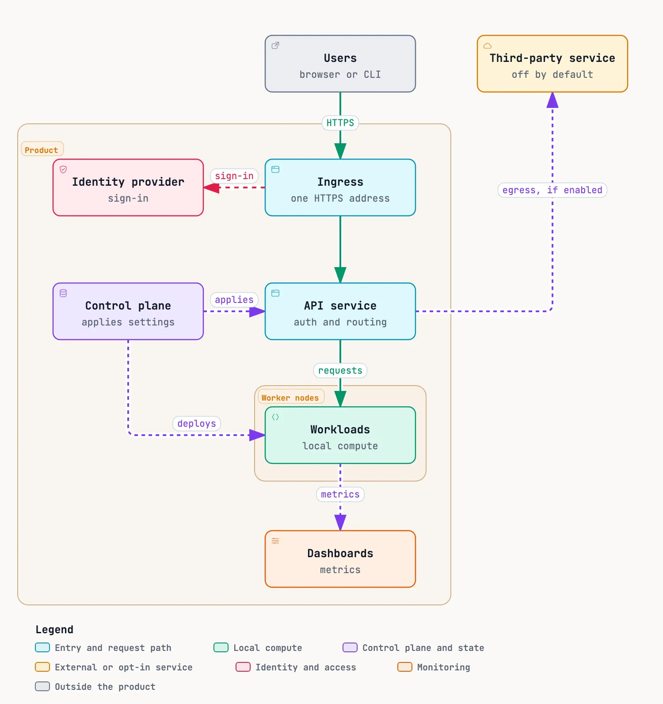
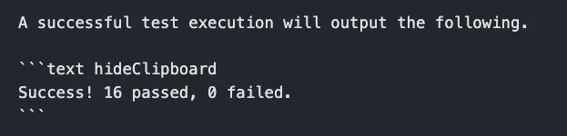
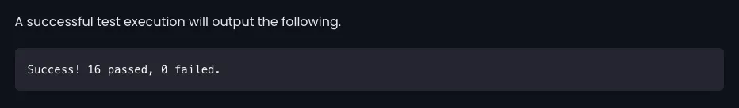

<!-- vale off -->

# Markdown and MDX

## Markdown Links and URLs

Markdown links use path references to link to other documentation pages. The markdown link contains the path to the page
in context from the current file. All references to another documentation page must end with the `.md` extension.

The build process automatically removes the `.md` extension from the URL during the compile. The path helps generate the
correct URL for the page when versioning is enabled.

The following example shows how to reference a page in common scenarios. Assume you have the following folder structure
when reviewing the examples.

```shell
.
└── docs
    └── docs-content
        ├── architecture
        │   ├── grpc.md
        │   └── ip-addresses.md
        ├── aws
        │   └── iam-permissions.md
        ├── clusters
        └── security.md
```

### Same Folder

To link to a file in the same folder, use the following syntax.

```md

```

Because the file is in the same folder, you don't need to specify the path to the file.

The build process automatically searches the current folder for the file when compiling the markdown content.

For example, to reference `ip-addresses.md` from `grpc.md`, use the following syntax.

```md

```

### Different Folder

To link to a file in a different folder, use either a relative path from the current file or an absolute path from the
`docs-content` root.

For example, to reference `iam-permissions.md` from `security.md`, use one of the following paths.

```md title="Relative path"

```

```md title="Absolute path"

```

To reference `iam-permissions.md` from `grpc.md`, use one of the following paths.

```md title="Relative path"

```

```md title="Absolute path"

```

### A Heading in the Same File

To link to a heading in the same file, use the following syntax.

```md
[Link to a heading in the same file](#heading-name)
```

The `#` symbol references a heading in the same file. Use lowercase characters for the heading name, and replace spaces
with a `-` symbol. The default behavior uses dashes to separate words in the URL.

### A Heading in a Different File

To link to a heading in a different file, use the following syntax.

```md
[Link to a heading in a different file](name_of_file.md#heading-name)
```

For example, to reference the `Palette gRPC API` heading in `security.md` from `grpc.md`, use the following syntax.

```md
[Link to a heading in a different file](../security.md#palette-grpc-api)
```

The important thing to remember is that the `#` comes after the file name and before the heading name.

### Linking to and from API Docs

In Docusaurus, a **plugin** is a separate content system that owns its own source files, routes, and sidebar. Each
plugin processes Markdown independently and maintains its own file-path-to-URL mapping.

This repository configures two docs plugins in `docusaurus.config.js`.

| Plugin                 | Source folder                | URL base | Content               |
| ---------------------- | ---------------------------- | -------- | --------------------- |
| Main docs (default)    | `docs/docs-content/`         | `/`      | Product documentation |
| API docs (`id: "api"`) | `docs/api-content/api-docs/` | `/api`   | API reference         |

> [!NOTE] Tutorials and Downloads have their own sidebars in the navbar, but they use the same plugin as the rest of the
> product docs. Their folders live within `docs/docs-content/` and use the same URL base (`/`). The site shows a
> different sidebar depending on which navbar item you select (configured in `sidebars.js` and `docusaurus.config.js`),
> but Docusaurus still processes all of those pages as one plugin. That is why a tutorial can link to a product doc with
> a path such as `../../profiles/profiles.md`, while a link to the API reference must use a URL path such as
> `/api/introduction`.

Path links with a `.md` extension only work **within the same plugin**. You can link from one product doc to another
using the path syntax described above because the main docs plugin processes both files under `docs/docs-content/`.

Docusaurus cannot resolve a `.md` path across plugins. For example, a link from `docs/docs-content/` to
`docs/api-content/api-docs/1-introduction.md` doesn't work, even though both folders live under `docs/`. To link between
plugins, use a **URL path** instead. Don't include a file extension in the link.

```md
<!-- From a page in docs/docs-content/ -->

[Palette API introduction](/api/introduction)

[API Key section](/api/introduction#api-key)

[Palette API v1 endpoints](/api/category/palette-api-v1/)
```

The same rule applies in reverse. From a page under `docs/api-content/`, link back to product docs with a URL path.

```md
<!-- From a page in docs/api-content/ -->

[Create API Key](/user-management/authentication/api-key/create-api-key)
```

Use the route path the page appears at on the site, not the folder path in the repository. For example, use
`/api/introduction`, not `/api-content/api-docs/1-introduction.md` or `/api-content/authentication`.

> [!NOTE] Root-relative URL paths such as `/api/introduction` resolve against the current host. On a legacy deployment
> such as [v4.8.x](https://version-4-8.legacy.docs.spectrocloud.com/), that link stays on the versioned site. Avoid
> hard-coded links to `https://docs.spectrocloud.com/...` in content that must work on archived versions, because those
> always point to the latest production site.

## Redirects

If a file already exists and you need to move it elsewhere, add a redirect entry that points from the old path to the
new path using the [redirects.js](../../redirects.js) file. This ensures that anywhere old links are used, whether that
be links embedded in the product or pages saved by customers, continue to work. Below is an example of what a redirect
entry should look like.

```js
  {
    from: `/clusters/nested-clusters/`,
    to: `/clusters/sandbox-clusters`,
  },
```

## Images or other assets

All images must reside in the [`static/assets/docs/images`](../../static/assets/docs/images/) folder. All images must be
in webp format. If you save png, jpg, or jpeg to the directory, the commit hook will convert the images to webp format.
Alternately, issue the command `make format-images` to convert the images to webp format.

```md

```

You can add a directory to the images folder.

```md

```

**Image Loading** Image size loading can be customized. You can provide eager-load to images in the first fold of the
image with high priority so LCP (Largest Contentful Paint) for the page is not affected.

```md

```

### Diagrams

You can author a new diagram as [Archify](https://github.com/tt-a1i/archify) JSON source and export it to two WEBP
images, one for the site's light theme and one for its dark theme. The JSON source is the source of truth. The WEBP
images are the rendered output that ships with the docs. Archify also renders an interactive HTML version of each
diagram. Use it locally to review the layout and the source links.

This section covers how to build a diagram with Archify. For what to draw and how a diagram reads, such as color roles,
arrows, labels, layout, and numbered callouts, refer to [Diagrams](../../style-guide.md#diagrams) in the style guide.

#### Diagram Types

Most diagrams in the docs are `architecture` diagrams, which show the components of a system and how they connect.
Archify also renders `sequence`, `workflow`, `dataflow`, `lifecycle`, `erd`, `tree`, `class`, `timeline`, and
`waterfall` diagrams. Each type has its own schema in the Archify `archify/schemas` folder. To find the right type for a
question, run the Archify `guide` command.

```shell
node ~/archify-v3.2.0/archify/bin/archify.mjs guide "<diagram-question>"
```

Replace `<diagram-question>` with a short description of what the diagram must explain.

For example, the following command asks which type suits a diagram of the calls that one chat request makes. Phrase the
question the way the diagram answers it, such as _who calls whom, in what order_. A question that matches none of
Archify's scenarios returns `System overview [architecture]` with low confidence.

```shell
node ~/archify-v3.2.0/archify/bin/archify.mjs guide "who calls whom, in what order, when a client sends a chat request"
```

```bash hideClipboard title="Expected output"
Recommendation: API request chain  [sequence]
Confidence: medium
Question answered: Who calls whom, in what order, and what returns?
```

The output also lists when to use the type, what the diagram must include, and a ready-to-use prompt for an AI coding
agent.

The Archify settings in [Component Types](#component-types), [Connection Variants](#connection-variants), and
[Boundary Types](#boundary-types) apply to `architecture` diagrams. For other types, follow the type's schema and keep
the same component names.

#### Component Types

Archify gives each component one of seven fixed types, and each type has its own color. You cannot set a custom color,
so set the `type` that matches the component's color role in the style guide's
[Color Roles](../../style-guide.md#color-roles).

| **Role**                   | **Archify `type`** |
| -------------------------- | ------------------ |
| Outside the product        | `external`         |
| Entry and request path     | `frontend`         |
| Local compute              | `backend`          |
| External or opt-in service | `cloud`            |
| Control plane and state    | `database`         |
| Identity and access        | `security`         |
| Monitoring                 | `messagebus`       |

Set each legend label with `meta.legend.entries.<type>.label`.

Give every component the same `size`, such as `[170, 64]`. The export script enlarges the text, so a label longer than
about 21 characters or a sub-label longer than about 23 characters does not fit on one line of a 170-pixel-wide
component, and the script warns when it overflows.

Archify `cards` appear in the interactive HTML but not in the exported image. Put anything you would write in a card in
the page prose instead.

#### Connection Variants

Set the `variant` of every connection to match its arrow style in the style guide's
[Arrows](../../style-guide.md#arrows).

| **Arrow**      | **Archify `variant`** |
| -------------- | --------------------- |
| Green, solid   | `emphasis`            |
| Slate, solid   | `default`             |
| Violet, dashed | `dashed`              |
| Rose, solid    | `security`            |

If Archify's automatic routing makes two connections cross, set `fromSide`, `toSide`, or `route` on one of them. If
Archify places a connection label on top of a component, set `labelAt` to an `[x, y]` point in the gap between two rows.
The `finalize` command in [Regenerate a Diagram](#regenerate-a-diagram) reports crossings and overlapping labels.

#### Boundary Types

Use a `region` boundary for the product boundary and for a nested hardware grouping. Use a `security-group` boundary for
a network or trust boundary.

A boundary's `pad` sets the space between the boundary and the components it wraps. Raise it, for example to `40`, when
a connection has to run along the inside edge of the boundary, so that the connection stays inside it.

#### Grid Positions

Place components with `pos` on a grid so that rows and columns line up. Columns at `x` 60, 300, and 540, and rows 140
pixels apart, starting at `y` 40, give the three-column layout in the style guide's
[Layout](../../style-guide.md#layout) and leave room for connection labels.

#### Source Evidence

When you have the product's source code, you can cite where each component is defined, and Archify checks each citation
when it validates the diagram. Use the repository's HTTPS URL, because Archify rejects SSH URLs. Set
`meta.repository.revision` to the commit of the release that the docs describe, not the tip of the default branch. For
the format of `meta.repository` and each component's `sources`, refer to the schemas in the Archify `archify/schemas`
folder.

The docs repository is public, so commit citations only when the product's source repository is public too. Citations to
a private repository would publish its name, its file paths, and its commit IDs. For a private repository, complete the
following steps.

1. Cite the sources in a copy of the JSON source outside the docs repository, and run `finalize` on that copy with
   `--repo-root`, as described in [Regenerate a Diagram](#regenerate-a-diagram).

2. Commit the JSON source without `meta.repository` and without any component's `sources`. Leave `meta.quality_profile`
   as it is, because the profile changes where Archify places connection labels.

3. Record the repository, the revision, and each component's citations in the diagram's Jira ticket, so that the next
   writer can check them against a new release.

#### Create or Update a Diagram

The docs repository authors diagrams with [Archify](https://github.com/tt-a1i/archify) v3.2.0, exports them with the
[`scripts/archify-export.mjs`](../../scripts/archify-export.mjs) script, and converts them to WEBP with
[`cwebp`](https://developers.google.com/speed/webp/download).

The JSON source for each diagram lives in an `archify/` subdirectory next to the page it belongs to, named
`<diagram-name>.<diagram-type>.json`. The exported WEBP images land under `static/assets/docs/images/` per the standard
image naming convention, as `<markdown-file-name>_<image-description>.webp` for the light theme and
`<markdown-file-name>_<image-description>-dark.webp` for the dark theme. Do not commit the interactive HTML, any
intermediate PNG, or the review files that Archify writes.

To create or update a diagram, complete the following steps.

1. Install the tools in [Prerequisites](#prerequisites).

2. Write or edit the diagram's JSON source in the `archify/` folder next to its page. For a new diagram, start from the
   [Sample](#sample). Follow the [Diagrams](../../style-guide.md#diagrams) conventions in the style guide and the
   Archify settings in this section.

3. Validate the source and export both images, as described in [Regenerate a Diagram](#regenerate-a-diagram).

4. For a new diagram, add it to its page, as described in [Add the Diagram to a Page](#add-the-diagram-to-a-page).

5. Commit the JSON source and both images together.

To have Claude Code complete steps 2 to 4 for you, use the `docs-diagram-from-source` skill, as described in
[Create a Diagram With an AI Agent](#create-a-diagram-with-an-ai-agent). To keep a diagram current when the product
changes, refer to [Maintain a Diagram](#maintain-a-diagram).

##### Prerequisites

- Node.js v24, as described in [Local Development](./local-development.md).

- Google Chrome. The export script uses the default macOS install location, then `google-chrome` on `PATH`. Set
  `CHROME_PATH` to use a different browser binary.

- `cwebp` on `PATH`. Install with `brew install webp` on macOS.

- The Archify v3.2.0 command-line tool, cloned outside the docs repository and checked out at the commit that the
  `v3.2.0` tag points to.

  ```shell
  git clone https://github.com/tt-a1i/archify.git ~/archify-v3.2.0
  git -C ~/archify-v3.2.0 -c advice.detachedHead=false checkout 208acba8d412335185b2056fedf54b3405df43fb
  ```

  ```bash hideClipboard title="Expected output"
  Cloning into '/Users/<username>/archify-v3.2.0'...
  HEAD is now at 208acba8 Merge pull request #1002 from tt-a1i/codex/promote-dev-20261018
  ```

##### Create a Diagram With an AI Agent

The docs team's internal `docs-diagram-from-source` skill runs the steps in this section for you in Claude Code. Given a
Jira ticket and a local clone of the product's source repository, the skill does the following:

- Builds an inventory of the components, with source citations pinned to the release that the docs describe.

- Drafts the JSON source, and runs `finalize` and both exports until they pass with no warnings.

- Adds the diagram to its page with the `ThemedImage` component and a numbered list.

- Runs Prettier and Vale, and reports its decisions, a source trace, SME questions, and the time the diagram took.

The skill does not commit, push, or change Jira. Review its diagram, its source trace, and its SME questions before you
open a pull request, and get SME sign-off as you would for any diagram. When the product's source repository is private,
the skill leaves the citations out of the JSON source, as described in [Source Evidence](#source-evidence), so record
its source trace in the Jira ticket.

Docs team members install the skill with the team's other Claude Code skills. The skill needs the same
[Prerequisites](#prerequisites). Then ask Claude Code to run it for the ticket.

```text
Use the docs-diagram-from-source skill for DOC-1234.
```

##### Regenerate a Diagram

1. Validate the JSON source and render it to a temporary HTML file. The `finalize` command fails if a component or a
   label overlaps another, if two connections cross, or if a source citation does not exist at the pinned revision.

   ```shell
   node ~/archify-v3.2.0/archify/bin/archify.mjs finalize <diagram-type> <json-source> /tmp/<diagram-name>.html \
     --quality showcase --repo-root <path-to-product-source> --out-dir /tmp/archify-review
   ```

   Replace the following placeholders:

   - `<diagram-type>` with the diagram's type, such as `architecture`.

   - `<json-source>` with the path to the diagram's JSON source.

   - `<diagram-name>` with a short name for the temporary files, such as the JSON file's name without its extensions.

   - `<path-to-product-source>` with the path to a local clone of the product's source repository that contains the
     pinned revision.

   For a diagram that does not cite its sources, use `--quality standard` and leave out `--repo-root`.

   ```bash hideClipboard title="Expected output"
   finalize pass: /tmp/<diagram-name>.html
   gates validate:pass deliver:pass check:pass browser-check:pass
   receipt /tmp/archify-review/<diagram-name>.finalize.json
   perceptual visual review not-requested
   ```

2. Export the rendered diagram to its final WEBP path, once for each theme. Add `dark` as the third argument for the
   dark theme.

   ```shell
   node scripts/archify-export.mjs /tmp/<diagram-name>.html \
     static/assets/docs/images/<markdown-file-name>_<image-description>.webp
   node scripts/archify-export.mjs /tmp/<diagram-name>.html \
     static/assets/docs/images/<markdown-file-name>_<image-description>-dark.webp dark
   ```

   Replace `<markdown-file-name>` with the name of the page's Markdown file and `<image-description>` with a short
   description of the diagram, as described in [Create or Update a Diagram](#create-or-update-a-diagram).

   The script removes Archify's title, frame, and grid, paints the canvas in the docs site's page color, enlarges the
   text and arrows, and renders the image at twice its size, so that the diagram stays legible after the docs site
   scales it down.

   ```bash hideClipboard title="Expected output"
   exported <diagram-title>-light.svg (theme=light) -> static/assets/docs/images/<markdown-file-name>_<image-description>.webp
   exported <diagram-title>-dark.svg (theme=dark) -> static/assets/docs/images/<markdown-file-name>_<image-description>-dark.webp
   ```

   The first file name on each line is the intermediate SVG that the Archify viewer exports. You can ignore it.

   A line that starts with `warning:` means that enlarged text overflows its component or a connection label overlaps a
   component. Fix the JSON source, and then run both steps again until the export prints no warnings.

Commit the updated JSON source and both regenerated WEBP images in the same change so that the source and the images
stay in sync.

##### Maintain a Diagram

Edit a diagram through its JSON source, never through its images. Update the diagram in the same change as the page
whenever any of the following happens:

- The product renames a component, or the console or the docs start using a different name for it.

- The product adds, removes, or reconnects a component that the diagram shows.

- A new release of the product ships, and the docs version that the diagram belongs to moves to it.

For a new release, check the diagram's source citations against it. When the product's source repository is private,
first add the citations from the diagram's Jira ticket to a copy of the JSON source outside the docs repository, as
described in [Source Evidence](#source-evidence). The commit history of the JSON source names the ticket. Set
`meta.repository.revision` to the full commit SHA of the new release, and then run `finalize` with `--repo-root`. The
command fails for every source citation whose file or line range no longer exists at that revision. Update each failing
citation, and then check whether the component it supports changed too. For a private repository, record the updated
citations in your change's Jira ticket. When the components change, update the numbered list on the page to match.
Callout numbers appear in both the JSON source and the page, so change both in the same commit. Then regenerate both
images, as described in [Regenerate a Diagram](#regenerate-a-diagram).

##### Add the Diagram to a Page

Use the `ThemedImage` component so that the page shows the image that matches the reader's theme. Import the component
after the page's front matter, and wrap it in a paragraph with the `markdown-image` class so that the diagram gets the
same centering, rounded corners, and click-to-zoom as other images.

```mdx
import ThemedImage from "@theme/ThemedImage";

<p>
  <ThemedImage
    className="markdown-image"
    alt="<alt-text>"
    sources={{
      light: "/assets/docs/images/<markdown-file-name>_<image-description>.webp",
      dark: "/assets/docs/images/<markdown-file-name>_<image-description>-dark.webp",
    }}
  />
</p>
```

Replace `<alt-text>` with the image's alt text, and replace `<markdown-file-name>` and `<image-description>` with the
values that you used in [Regenerate a Diagram](#regenerate-a-diagram).

#### Sample

The following diagram uses every color role, every arrow variant, a nested boundary, and the three-column layout. Use it
as a reference when you introduce a new component and are unsure which role it belongs to. GitHub renders this guide,
not the docs site, so the sample ships only its light-theme image.



The JSON source for this sample lives at
[`docs/contributing/archify/diagramming-conventions-sample.architecture.json`](./archify/diagramming-conventions-sample.architecture.json).
Use it as a starting point when you author a new diagram.

## Code Lines Highlighter

You can highlight specific lines in a block of code by using a
[metadata string](https://docusaurus.io/docs/markdown-features/code-blocks#highlighting-with-metadata-string) in the
header of the code block.

For example, the following code block declaration highlights lines 1 and 3.

````md
```text {1,3}
line one
line two
line three
```
````

### Hide Clipboard Button

The copy button is shown by default in all code blocks. You can disable the copy button by passing in the parameter
value `hideClipboard` in the markdown declaration of the code blocks. This is useful for example output where the user
doesn't need to copy or use the content.

Example 

Result



## Admonitions - Warning / Info / Tip / Danger / Tech Preview / Further Guidance / Deprecated

For guidance on using admonitions in the docs, refer to the
[Spectro Cloud Internal Style Guide: Admonitions](../../style-guide.md#admonitions).

To learn more about admonitions in Docusaurus, refer to the
[Admonitions](https://docusaurus.io/docs/markdown-features/admonitions) guide.

The content must have a new line at the beginning and at the end of the tag.

### Warning

```mdx
:::warning

Some **content** with _Markdown_ `syntax`.

:::
```

### Info

```mdx
:::info

Some **content** with _Markdown_ `syntax`.

:::
```

### Tip

```mdx
:::tip

Some **content** with _Markdown_ `syntax`.

:::
```

### Danger

```mdx
:::danger

Some **content** with _Markdown_ `syntax`.

:::
```

### Tech Preview

The `:::preview` admonition is a custom admonition configured in `docusaurus.config.js` under `admonitions.keywords`.

Unlike other admonition types, you don't need to enter content in the admonition block. By default, the Tech Preview
admonition generates the message, "This is a Tech Preview feature and is subject to change. Don't use this feature in
production workloads." This message is hardcoded using `src/theme/Admonition/Type/TechPreview.js`. If you need to
deviate from the template text, you can provide a custom message.

```mdx
:::preview

Some **content** with _Markdown_ `syntax`.

:::
```

Files in `docs/docs-content` and `docs/api-content` are processed during the build phase. Partials in the `_partials`
directory are dynamically imported at runtime. Because of this, custom admonitions defined in `docusaurus.config.js`
that are used in partials are not rendered, and the custom admonition is ignored.

As a workaround, when using custom admonitions in partials, import and reference the admonition with JSX syntax.

```mdx
import AdmonitionTypeTechPreview from '@theme/Admonition/Type/TechPreview'; # Import below front matter

<AdmonitionTypeTechPreview /> # Use instead of :::
```

Note that when used in partials, the default message cannot be overridden.

### Further Guidance

```mdx
:::further

Some **content** with _Markdown_ `syntax`.

:::
```

Like Tech Preview, the Further Guidance admonition is a custom admonition. To use this admonition in partials, you must
import and reference it with JSX syntax.

```mdx
import AdmonitionTypeFurtherGuidance from '@theme/Admonition/Type/FurtherGuidance'; # Import below front matter

<AdmonitionTypeFurtherGuidance /> # Use instead of :::
```

### Deprecated

The `:::deprecated` admonition is a custom admonition configured in `docusaurus.config.js` under `admonitions.keywords`.

Unlike other admonition types, you do not need to enter content in the admonition block. By default, the Deprecated
admonition generates the message, "This feature is deprecated and will no longer receive new updates. Refer to the
Announcements page for additional information, as well as alternatives." This message is hardcoded using
`src/theme/Admonition/Type/Deprecated.js`. However, you can provide a custom message when you need different text.

```mdx
:::deprecated

Some **content** with _Markdown_ `syntax`.

:::
```

Like Tech Preview and Further Guidance, the Deprecated admonition is a custom admonition. To use this admonition in
partials, import and reference it with JSX syntax.

```mdx
import AdmonitionTypeDeprecated from '@theme/Admonition/Type/Deprecated'; # Import below front matter

<AdmonitionTypeDeprecated /> # Use instead of :::
```

When you use the Deprecated admonition in partials, you cannot override the default message.
