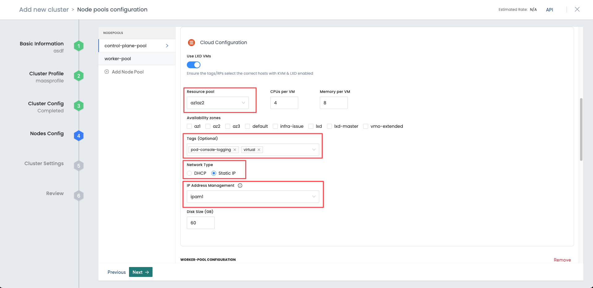

Palette supports creating and managing Kubernetes clusters deployed to a MAAS account with LXD Virtual Machines (VMs)
enabled. This feature allows you to spawn multiple control plane nodes as LXD VMs and consolidate them on MAAS-managed
servers, while your worker nodes run on bare metal. This improves resource utilization by reducing the number of bare
metal machines needed to run control planes and keeps virtualization overhead low.

## Limitations

<!-- prettier-ignore-start -->

The deployment of MAAS clusters to LXD VMs is limited to the Kubernetes distribution <VersionedLink text="Palette eXtended Kubernetes (PXK)" url="/integrations/packs/?pack=kubernetes" />.

<!-- prettier-ignore-end -->

## Prerequisites

- A [MAAS account registered in Palette](register-manage-maas-cloud-accounts.md). All MAAS-registered Palette accounts
  must use either a System Private Gateway or Private Cloud Gateway (PCG) to connect to the MAAS environment. For more
  information on which PCG to use, refer to our MAAS [Architecture](./architecture.md) guide.

  - If you want to use a static network range for the workload cluster's control plane, ensure you have configured an IP
    pool on the [IP Address Management (IPAM)](../../pcg/manage-pcg/create-manage-node-pool.md) tab of the PCG. The IP
    pool must have **Restrict to a single cluster** enabled.

  - If your Palette instance does not have a direct connection to the MAAS environment, you must manually
    [deploy a PCG cluster](../../pcg/deploy-pcg/maas.md) to your MAAS environment.
  - If you are using a self-hosted Palette or Palette VerteX instance that has a direct connection to your MAAS
    environment, you can use Palette's [System Private Gateway](../../pcg/architecture.md#system-private-gateway).

- A [cluster profile](../../../profiles/cluster-profiles/cluster-profiles.md) for the MAAS environment. The Operating
  System (OS) image used in your cluster profile must be downloaded and available in your MAAS environment. Review
  [How to use standard images](https://canonical.com/maas/docs/about-images) for guidance on downloading OS images for
  MAAS.

- MAAS hosts that support KVM or LXD VMs.

- The **LxdMaas** feature flag enabled in the
  [system console](../../../enterprise-version/system-management/feature-flags.md).

:::info

<!-- prettier-ignore-start -->

By default, Palette registers a Domain Name System (DNS) record in MAAS for the deployed cluster and links it to the IP addresses of the
control plane nodes. However, you can use the <VersionedLink text="Palette eXtended Kubernetes (PXK)" url="/integrations/packs/?pack=kubernetes&tab=custom#custom-api-server-endpoint-for-maas-clusters" /> pack to configure a custom API server endpoint for your cluster instead.

<!-- prettier-ignore-end -->

:::

- If configuring the **Cert Manager** pack , ensure that you use version 1.19.1 or later. It is also important to
  ensure:
  - `crds.enabled` is set to `false`.
  - `cainjector.enabled` is set to `false` or `cainjector.replicas` is set to `0`.
  - `nodeSelector` or `nodeAffinity` is set to prevent scheduling of Cert Manager on control pane nodes.

## Deploy a MAAS Cluster with LXD-Enabled

Deploying a MAAS cluster with LXD enabled is a two-step process. First, you deploy your host cluster nodes on bare-metal
MAAS servers that have LXD enabled. Then, you deploy your workload cluster with its control plane nodes as LXD VMs that
are managed by the host cluster. The worker nodes are still deployed on bare-metal MAAS servers.

### Deploy a Host Cluster with LXD-Enabled MAAS Hosts

1.  Log in to [Palette](https://console.spectrocloud.com).

2.  Ensure you are in the correct project scope.

3.  From the left main menu, select **Clusters**, and choose either **Create Cluster** or **Add New Cluster**.

4.  In the **Data Center** section, select **MAAS**.

5.  In the bottom-right corner, click **Start MAAS Configuration**.

6.  Complete the following information. Select **Next** when finished.

    | **Field**         | **Description**                                                                                                                                                                                                                          |
    | ----------------- | ---------------------------------------------------------------------------------------------------------------------------------------------------------------------------------------------------------------------------------------- |
    | **Cluster Name**  | Enter a custom name for the cluster.                                                                                                                                                                                                     |
    | **Description**   | (Optional) Provide context about the cluster.                                                                                                                                                                                            |
    | **Tags**          | (Optional) Assign any desired cluster tags. You can use tags to filter and organize clusters in Palette. Example: `env:test`.                                                                                                            |
    | **Cloud Account** | Select the appropriate MAAS account under which to deploy the cluster. If the account is not listed, select **Add New Account**, and follow the prompts to [add your MAAS account](./register-manage-maas-cloud-accounts.md) to Palette. |

7.  <PartialsComponent category="cluster-templates" name="profile-vs-template" />

8.  <PartialsComponent category="profiles" name="cluster-profile-variables-deployment" />

9.  Fill out the following fields on the **Cluster Config** step.

    | **Field**                                      | **Description**                                                                                                                                                                                                                                                                                                                                                                                                                                                                                                                                                                |
    | ---------------------------------------------- | ------------------------------------------------------------------------------------------------------------------------------------------------------------------------------------------------------------------------------------------------------------------------------------------------------------------------------------------------------------------------------------------------------------------------------------------------------------------------------------------------------------------------------------------------------------------------------ |
    | **Domains**                                    | Register a DNS record in the selected domain for the deployed cluster. The DNS record links to the IP addresses of the control plane nodes.                                                                                                                                                                                                                                                                                                                                                                                                                                    |
    | **SSH Keys (Optional)**                        | Inject public Secure Shell (SSH) keys into `~/.ssh/authorized_keys` on each control plane and worker node, including LXD VMs, without removing existing MAAS users. The list is populated using the keys in **Tenant Settings** or **Project Settings** > **Security** > **SSH Keys**. Select **Add Item** to [add additional keys](../../cluster-management/ssh/ssh-keys.md). Refer to [SSH Keys on MAAS Cluster Nodes](architecture.md#ssh-keys-on-maas-cluster-nodes) for details on supported distributions.                                                               |
    | **NTP Servers (Optional)**                     | Specify Network Time Protocol (NTP) servers for the cluster nodes. The servers you provide override the machine image defaults. We recommend specifying at least one NTP server to prevent time drift issues. Refer to [NTP Servers on MAAS Cluster Nodes](architecture.md#ntp-servers-on-maas-cluster-nodes) for details on supported distributions.                                                                                                                                                                                                                          |
    | **Override Cluster API cluster configuration** | Enable if you want to provide custom Cluster API manifests in YAML format. This is an advanced option that allows you to customize the underlying CAPI objects used to provision and manage your cluster. When enabled, the **Update Cluster API cluster configuration** option becomes available. Click this button to view the YAML code editor drawer, where you can provide your override configuration. Review the [Override CAPI Properties](../../../architecture/override-capi-properties/override-capi-properties.md) documentation to learn more about this feature. |

10. Click the **Host LXD-Based Control Planes** toggle to use this cluster as an LXD-based control plane (hypervisor)
    for running control plane components as LXD VMs. Select **Next**.

    

11. Configure the control plane and, optionally, worker node pools.

    The following input fields apply to MAAS control plane and worker node pools. For a detailed list of input fields
    that are common across environments and their usage, refer to our
    [Node Pools](../../cluster-management/node-pool.md#node-pool-configuration-settings) guide. Select **Next** when
    finished.

    | **Parameter**                                               | **Description**                                                                                                                                                                                                                                                                                                                                                                                                                                                                                                                                                                    |
    | ----------------------------------------------------------- | ---------------------------------------------------------------------------------------------------------------------------------------------------------------------------------------------------------------------------------------------------------------------------------------------------------------------------------------------------------------------------------------------------------------------------------------------------------------------------------------------------------------------------------------------------------------------------------- |
    | **Resource pool**                                           | The MAAS resource pool from which to deploy nodes.                                                                                                                                                                                                                                                                                                                                                                                                                                                                                                                                 |
    | **Minimum CPU**                                             | Only select machines from the **Resource pool** that have at least the specified amount of CPU.                                                                                                                                                                                                                                                                                                                                                                                                                                                                                    |
    | **Minimum Memory**                                          | Only select machines from the **Resource pool** that have at least the specified amount of memory.                                                                                                                                                                                                                                                                                                                                                                                                                                                                                 |
    | **Availability zones**                                      | The MAAS zones in which to deploy nodes. Palette distributes nodes across the selected zones for high availability.                                                                                                                                                                                                                                                                                                                                                                                                                                                                |
    | **Override Cluster API node pool configuration (Optional)** | Enable if you want to provide custom Cluster API manifests in YAML format. This is an advanced option that allows you to customize the underlying CAPI objects used to provision and manage your node pool. When enabled, the **Update Cluster API node pool configuration** option becomes available. Click this button to view the YAML code editor drawer, where you can provide your override configuration. Review the [Override CAPI Properties](../../../architecture/override-capi-properties/override-capi-properties.md) documentation to learn more about this feature. |
    | **Tags**                                                    | Controls which MAAS machines to use for the node pool based on [MAAS tags](https://canonical.com/maas/docs/stable/explanation/machine-groups/#tags-flexible-labels). If you specify multiple tags, Palette only selects machines that have _all_ of the specified tags. <br /> <br /> **WARNING:** Modifying tags on an existing node pool triggers a node repave.                                                                                                                                                                                                                 |

12. <PartialsComponent category="clusters" name="cluster-settings" />

13. Select **Validate** to review your cluster configurations and settings.

14. If no changes are needed, select **Finish Configuration** to deploy your cluster.

To monitor the status of your cluster deployment, from the left main menu, select **Clusters** and choose your cluster.
The cluster **Overview** tab displays the status and health of your cluster, as well as deployment details. Use the
**Events** tab to monitor the deployment in real time. Provisioning may take several minutes.

### Deploy a Workload Cluster with LXD VMs as Control Plane Nodes

1.  Log in to [Palette](https://console.spectrocloud.com).

2.  Ensure you are in the correct project scope.

3.  From the left main menu, select **Clusters**, and choose either **Create Cluster** or **Add New Cluster**.

4.  In the **Data Center** section, select **MAAS**.

5.  In the bottom-right corner, click **Start MAAS Configuration**.

6.  Enter the basic information for your cluster, including the **Cluster name**, **Description**, and **Tags**.

7.  From the **Cloud Account** drop-down menu, select your MAAS cloud account, and click **Next**.

8.  <PartialsComponent category="cluster-templates" name="profile-vs-template" />

    #### Additional Configurations

    - To use two subnets, add the `cloud.maas.lxdVMSubnets` configuration to the Kubernetes layer of your cluster
      profile. The first subnet must specify the preboot execution environment (PXE), used for the initial booting and
      provisioning of LXD virtual machines, and the second must specify the subnet used to configure static IPs for
      workload traffic.

           ```yaml title="Example LXD subnet configuration" hideClipboard
           cloud:
             maas:
               lxdVMSubnets: 10.11.160.0/24,10.10.128.0/18
           ```

9.  <PartialsComponent category="profiles" name="cluster-profile-variables-deployment" />

10. Fill out the following fields on the **Cluster Config** step.

    | **Field**                                      | **Description**                                                                                                                                                                                                                                                                                                                                                                                                                                                                                                                                                                |
    | ---------------------------------------------- | ------------------------------------------------------------------------------------------------------------------------------------------------------------------------------------------------------------------------------------------------------------------------------------------------------------------------------------------------------------------------------------------------------------------------------------------------------------------------------------------------------------------------------------------------------------------------------ |
    | **Domains**                                    | Register a DNS record in the selected domain for the deployed cluster. The DNS record links to the IP addresses of the control plane nodes.                                                                                                                                                                                                                                                                                                                                                                                                                                    |
    | **SSH Keys (Optional)**                        | Inject public Secure Shell (SSH) keys into `~/.ssh/authorized_keys` on each control plane and worker node, including LXD VMs, without removing existing MAAS users. The list is populated using the keys in **Tenant Settings** or **Project Settings** > **Security** > **SSH Keys**. Select **Add Item** to [add additional keys](../../cluster-management/ssh/ssh-keys.md). Refer to [SSH Keys on MAAS Cluster Nodes](architecture.md#ssh-keys-on-maas-cluster-nodes) for details on supported distributions.                                                               |
    | **NTP Servers (Optional)**                     | Specify Network Time Protocol (NTP) servers for the cluster nodes. The servers you provide override the machine image defaults. We recommend specifying at least one NTP server to prevent time drift issues. Refer to [NTP Servers on MAAS Cluster Nodes](architecture.md#ntp-servers-on-maas-cluster-nodes) for details on supported distributions.                                                                                                                                                                                                                          |
    | **Override Cluster API cluster configuration** | Enable if you want to provide custom Cluster API manifests in YAML format. This is an advanced option that allows you to customize the underlying CAPI objects used to provision and manage your cluster. When enabled, the **Update Cluster API cluster configuration** option becomes available. Click this button to view the YAML code editor drawer, where you can provide your override configuration. Review the [Override CAPI Properties](../../../architecture/override-capi-properties/override-capi-properties.md) documentation to learn more about this feature. |

11. When creating a workload cluster that will leverage MAAS LXD or will use an existing host LXD-based control plane,
    leave the **Host LXD-Based Control Planes** option disabled. Select **Next**.

    

12. Configure the control plane and worker node pools. The following input fields apply to MAAS node pools. For a
    detailed list of input fields that are common across environments and their usage, refer to our
    [Node Pools](../../cluster-management/node-pool.md#node-pool-configuration-settings) guide. Select **Next** when
    finished.

    #### Cloud Configuration

    | **Parameter**                                               | **Description**                                                                                                                                                                                                                                                                                                                                                                                                                                                                                                                                                                    |
    | ----------------------------------------------------------- | ---------------------------------------------------------------------------------------------------------------------------------------------------------------------------------------------------------------------------------------------------------------------------------------------------------------------------------------------------------------------------------------------------------------------------------------------------------------------------------------------------------------------------------------------------------------------------------- |
    | **Use LXD VMs**                                             | Select this option to deploy the workload cluster's control plane nodes as LXD VMs instead of on bare metal MAAS servers. This option is only displayed if you have KVM or LXD enabled on MAAS and you did _not_ select **Host LXD-Based Control Planes** in step 11.                                                                                                                                                                                                                                                                                                              |
    | **Resource pool**                                           | The MAAS resource pool from which to deploy nodes.                                                                                                                                                                                                                                                                                                                                                                                                                                                                                                                                 |
    | **Minimum CPU**                                             | Only select machines from the **Resource pool** that have at least the specified amount of CPU.                                                                                                                                                                                                                                                                                                                                                                                                                                                                                    |
    | **Minimum Memory**                                          | Only select machines from the **Resource pool** that have at least the specified amount of memory.                                                                                                                                                                                                                                                                                                                                                                                                                                                                                 |
    | **Availability zones**                                      | The MAAS zones in which to deploy nodes. Palette distributes nodes across the selected zones for high availability. These must match the same zones used by the hosted LXD-based control plane.                                                                                                                                                                                                                                                                                                                                                                                    |
    | **Override Cluster API node pool configuration (Optional)** | Enable if you want to provide custom Cluster API manifests in YAML format. This is an advanced option that allows you to customize the underlying CAPI objects used to provision and manage your node pool. When enabled, the **Update Cluster API node pool configuration** option becomes available. Click this button to view the YAML code editor drawer, where you can provide your override configuration. Review the [Override CAPI Properties](../../../architecture/override-capi-properties/override-capi-properties.md) documentation to learn more about this feature. |
    | **Tags**                                                    | Control which MAAS machines to use for the node pool based on [MAAS tags](https://canonical.com/maas/docs/stable/explanation/machine-groups/#tags-flexible-labels). If you specify multiple tags, Palette only selects machines that have _all_ of the specified tags. If you use a hosted LXD-based control plane, the resource pool, availability zones, and tags must match the values that you set for the host cluster nodes. <br /> <br /> **WARNING:** Modifying tags on an existing node pool triggers a node repave.                                                      |
    | **Network Type**                                            | (Control plane pools only) Select **MAAS Automatic** or **Palette Static IP Pool**. For **Palette Static IP Pool**, select the **IP Address Management** drop-down and choose the desired [IPAM node pool](../../pcg/manage-pcg/create-manage-node-pool.md). The IP pool must have **Restrict to a single cluster** enabled. This option is only available when **Use LXD VMs** is enabled for the control plane pool.                                                                                                                                                             |

    :::danger

    Ensure that your **Resource pool**, **Availability zones**, and **Tags** selections match the same values used for
    the host cluster nodes. Failure to do so may result in LXD VMs created on MAAS hosts that do not have LXD
    initialized, which can lead to cluster provisioning failures.

    :::

    

13. <PartialsComponent category="clusters" name="cluster-settings" />

14. Select **Validate** to review your cluster configurations and settings.

15. If no changes are needed, select **Finish Configuration** to deploy your cluster.

To monitor the status of your cluster deployment, from the left main menu, select **Clusters** and choose your cluster.
The cluster **Overview** tab displays the status and health of your cluster, as well as deployment details. Use the
**Events** tab to monitor the deployment in real time. Provisioning may take several minutes.

## Validate

Use the following steps to validate that your cluster is up and in the **Running** state.

1. Log in to [Palette](https://console.spectrocloud.com).

2. Ensure you are in the correct project scope.

3. From the left main menu, select **Clusters**. The **Clusters** page displays a list of all available clusters that
   Palette manages.

4. Select the cluster you deployed. On the **Overview** tab, ensure the **Cluster Status** is **Running** and that the
   cluster has a **Health** status of **Healthy**.

## Update a MAAS Cluster

:::warning

Ensure that the OS image used in your cluster profile is downloaded and available in your MAAS environment before
attempting to update your cluster. Review [How to use standard images](https://canonical.com/maas/docs/about-images) for
guidance on downloading compatible OS images for MAAS.

:::

Updates can include changes to the cluster configuration, such as a Kubernetes upgrade, or a node configuration, such as
changing the CPU or memory requirements, or picking a different availability zone. These updates are orchestrated using
a rolling repave of the cluster nodes. To learn more about managing a MAAS cluster, refer to
[Manage Clusters](../../cluster-management/cluster-updates.md).

Updating the host cluster causes a rolling repave across nodes. During the repave, nodes running older versions are
removed, and the associated LXD VMs are deleted. If the leader node is deleted, the control plane components of the
workload cluster undergo a new leader election process and choose a new leader on an LXD VM running on a different node.
For this reason, it is _critical_ that the host and workload clusters are configured for high availability, consisting
of at least three nodes per cluster, with the nodes spread across different availability zones.

Workload cluster updates function the same as regular MAAS clusters. Instead of provisioning new bare-metal hosts, new
LXD VMs are created for the control plane nodes.

To protect your data, we recommend creating a backup of your MAAS cluster before proceeding with any updates or
infrastructure changes. Review our [Backup and Restore](../../cluster-management/backup-restore/backup-restore.md) guide
for additional information.

## Manage LXD Host Maintenance

An LXD host is a host cluster node that runs the control plane LXD VMs of your workload clusters. Place an LXD host
under maintenance before you service it, for example, to apply firmware updates, replace hardware, or reboot the
machine. You can cordon the host so that Palette stops placing new LXD VMs on it, or place it under full maintenance so
that Palette also evacuates the control plane LXD VMs that already run on it.

You control host maintenance with MAAS tags that you apply in MAAS, not to a cluster or node pool in Palette. MAAS
tracks each LXD host as two separate objects: the bare-metal machine, such as `bm-01` on the **Machines** page, and a VM
host that Palette creates for it when it registers the machine, such as `lxd-host-bm-01` on the **LXD** page. Apply
maintenance tags to the machine. Tags on the VM host, or on the control plane LXD VMs, which MAAS lists as separate
machines, have no effect on host maintenance. For more information about MAAS tags, refer to the
[MAAS tags](https://canonical.com/maas/docs/stable/explanation/machine-groups/#tags-flexible-labels) documentation.

### Prerequisites {#prerequisites-host-maintenance}

- A MAAS user with administrator privileges.

- The MAAS CLI and `jq` installed on your workstation. The **MAAS CLI** steps and the
  [full maintenance validation](#validate-full-maintenance) use both tools. The **MAAS CLI** steps for full maintenance
  also use `uuidgen`.

- A MAAS API key for the MAAS CLI. Refer to the
  [MAAS API keys](https://canonical.com/maas/docs/stable/how-to-guides/enhance-maas-security/#manage-api-keys)
  documentation for guidance on obtaining your API key.

### Host Maintenance Tags

The following tags control the maintenance state of an LXD host.

| **Tag**                          | **Purpose**                                                                                                                                                                            | **Required For**            |
| -------------------------------- | -------------------------------------------------------------------------------------------------------------------------------------------------------------------------------------- | --------------------------- |
| `maas-lxd-host-noschedule`       | Cordons the host so that Palette does not place new LXD VMs on it.                                                                                                                     | Cordon and full maintenance |
| `maas-lxd-host-maintenance`      | Marks the host for maintenance. Palette evacuates its control plane LXD VMs only when the host carries all three tags.                                                                 | Full maintenance            |
| `maas-lxd-hcp-op-<operation-id>` | Identifies a single maintenance operation. `<operation-id>` is any value that is unique to this operation, such as `bm-01-20261123`. Use only lowercase letters, numbers, and hyphens. | Full maintenance            |

A host that carries either the `maas-lxd-host-noschedule` tag or the `maas-lxd-host-maintenance` tag receives no new LXD
VMs.

Palette matches the tag names literally, so enter them exactly as shown. A typo prevents the host from entering
maintenance.

:::warning

Palette applies the same three tags to a host when it replaces a node in the host cluster and removes them when the
evacuation finishes. If a host carries a `maas-lxd-hcp-op-<operation-id>` tag that you did not apply, Palette is
replacing it. Do not add or remove the `maas-lxd-host-noschedule`, `maas-lxd-host-maintenance`, or
`maas-lxd-hcp-op-<operation-id>` tags on a host while Palette replaces it.

:::

### Cordon a Host

Cordon a host to stop Palette from placing new LXD VMs on it. The control plane LXD VMs that already run on the host
keep running. We recommend that you cordon a host as the first step before you service it.

<Tabs groupId="maas-interface">

<TabItem label="MAAS UI" value="maas-ui">

1. Log in to the MAAS UI.

2. From the left main menu, select **Machines**.

3. Select the machine of the LXD host that you want to cordon, such as `bm-01`. Do not select one of its control plane
   LXD VMs.

4. Select the **Configuration** tab.

5. In the **Tags** section, select **Edit**.

6. In the **Search existing or add new tags** field, enter `maas-lxd-host-noschedule`.

   - If the tag exists in MAAS, select it from the list.

   - If the tag does not exist, select **Create tag "maas-lxd-host-noschedule"**. In the **Create tag** form, select
     **Create and add to tag changes**.

   The tag appears under **To be added**.

7. Select **Save tag changes** to apply the tag to the host.

8. Verify that the **Tags** section lists `maas-lxd-host-noschedule`.

</TabItem>

<TabItem label="MAAS CLI" value="maas-cli">

1. Log in to MAAS with the MAAS CLI. The following command creates a MAAS CLI profile named `admin`, which the MAAS CLI
   commands on this page use. If you choose a different profile name, use it in place of `admin` in each command.

   ```bash
   maas login admin http://<maas-host>:5240/MAAS <api-key>
   ```

   Replace `<maas-host>` with the IP address or hostname of your MAAS server and `<api-key>` with your MAAS API key.

2. (Optional) If the `maas-lxd-host-noschedule` tag does not exist in MAAS, create it. If the tag already exists, the
   command returns the error `Tag with this Name already exists.` Continue to the next step.

   ```bash
   maas admin tags create name=maas-lxd-host-noschedule comment="Block new LXD VM placement"
   ```

3. List the VM hosts that Palette created and the system ID of the machine behind each one. Note the system ID for the
   LXD host that you want to cordon.

   ```bash
   maas admin vm-hosts read | jq --raw-output '.[] | select(.name | startswith("lxd-host-")) | "\(.name) \(.host.system_id)"'
   ```

   ```text hideClipboard title="Example Output"
   lxd-host-bm-01 4y3h7n
   lxd-host-bm-02 8k2p6q
   ```

4. Apply the tag to the host.

   ```bash
   maas admin tag update-nodes maas-lxd-host-noschedule add=<system-id>
   ```

   Replace `<system-id>` with the system ID from step 3.

5. Verify that the host carries the tag.

   ```bash
   maas admin machine read <system-id> | jq '.tag_names'
   ```

   Replace `<system-id>` with the system ID from step 3. The output lists `maas-lxd-host-noschedule` along with any
   other tags that the host carries.

   ```text hideClipboard title="Example Output"
   [
     "maas-lxd-host-noschedule"
   ]
   ```

</TabItem>

</Tabs>

To resume scheduling on the host, refer to [Lift Host Maintenance](#lift-host-maintenance).

### Place a Host under Full Maintenance

Full maintenance cordons the host _and_ evacuates the control plane LXD VMs that already run on it. Palette replaces
each control plane LXD VM on the host with a new VM on another eligible host. It replaces one VM at a time and waits
until the control plane of the workload cluster is stable before it replaces the next VM. When the evacuation finishes,
you can safely take the host offline.

:::warning

Before you start a full maintenance operation, review the following evacuation limits. If your environment does not meet
them, Palette might not be able to evacuate the host.

- Palette places each replacement VM only on a host that has spare capacity and is in the same availability zone as the
  original VM.

- Palette cannot evacuate the control plane of a workload cluster that has two control plane nodes. Palette can evacuate
  a single-node control plane, but we recommend three control plane nodes, because Palette removes one at a time and the
  other two keep the control plane running.

:::

To start a full maintenance operation, apply all three [host maintenance tags](#host-maintenance-tags) to the host. If
you already [cordoned the host](#cordon-a-host), it carries the `maas-lxd-host-noschedule` tag, so apply only the other
two tags.

<Tabs groupId="maas-interface">

<TabItem label="MAAS UI" value="maas-ui">

1. Choose an operation ID that is unique to this maintenance operation, such as the machine name and the date,
   `bm-01-20261123`. Use only lowercase letters, numbers, and hyphens, because Palette also uses the ID in the tag that
   it applies to each replacement VM. Record the value, because you need it to validate the evacuation.

2. Log in to the MAAS UI.

3. From the left main menu, select **Machines**.

4. Select the machine of the LXD host that you want to place under maintenance, such as `bm-01`. Do not select one of
   its control plane LXD VMs.

5. Select the **Configuration** tab.

6. In the **Tags** section, select **Edit**.

7. In the **Search existing or add new tags** field, add each of the following tags.

   - `maas-lxd-host-maintenance`

   - `maas-lxd-hcp-op-<operation-id>`

   - `maas-lxd-host-noschedule`, if the host is not cordoned

   Replace `<operation-id>` with the operation ID from step 1. Select a tag that exists in MAAS from the list. For a tag
   that does not exist, select its **Create tag** option, and then select **Create and add to tag changes** in the
   **Create tag** form. The tags appear under **To be added**.

8. Select **Save tag changes** to apply the tags to the host.

9. Verify that the **Tags** section lists `maas-lxd-host-noschedule`, `maas-lxd-host-maintenance`, and
   `maas-lxd-hcp-op-<operation-id>`.

</TabItem>

<TabItem label="MAAS CLI" value="maas-cli">

Run the following commands in the same terminal session, because later steps use the `OP_ID` shell variable.

1. Log in to MAAS, and find the system ID of the host. Use steps 1 and 3 of the **MAAS CLI** tab in
   [Cordon a Host](#cordon-a-host).

2. Generate a unique operation ID, and print it. Record the value, because you need it to validate the evacuation.

   ```bash
   OP_ID=$(uuidgen | tr '[:upper:]' '[:lower:]')
   echo $OP_ID
   ```

3. Create the maintenance and operation tags in MAAS. If the `maas-lxd-host-maintenance` tag already exists, skip the
   first command.

   ```bash
   maas admin tags create name=maas-lxd-host-maintenance comment="Evacuate LXD VMs from host"
   maas admin tags create name=maas-lxd-hcp-op-${OP_ID} comment="Maintenance operation ${OP_ID}"
   ```

4. (Optional) If the host is not cordoned, apply the `maas-lxd-host-noschedule` tag. If the tag does not exist in MAAS,
   create it first, as described in step 2 of the **MAAS CLI** tab in [Cordon a Host](#cordon-a-host).

   ```bash
   maas admin tag update-nodes maas-lxd-host-noschedule add=<system-id>
   ```

   Replace `<system-id>` with the system ID of the host.

5. Apply the maintenance and operation tags to the host.

   ```bash
   maas admin tag update-nodes maas-lxd-host-maintenance add=<system-id>
   maas admin tag update-nodes maas-lxd-hcp-op-${OP_ID} add=<system-id>
   ```

   Replace `<system-id>` with the system ID of the host.

6. Verify that the host carries all three tags.

   ```bash
   maas admin machine read <system-id> | jq '.tag_names'
   ```

   Replace `<system-id>` with the system ID of the host.

   ```text hideClipboard title="Example Output"
   [
     "maas-lxd-host-noschedule",
     "maas-lxd-host-maintenance",
     "maas-lxd-hcp-op-0b6f8d3e-5c1a-4e2b-9f7d-2a4c6e8b1d3f"
   ]
   ```

</TabItem>

</Tabs>

#### Validate {#validate-full-maintenance}

After you apply the tags, Palette begins to evacuate the control plane LXD VMs from the host. When the control plane of
a workload cluster is stable on a replacement VM, Palette applies the `maas-lxd-ready-op-<operation-id>` tag to that VM.
The evacuation is complete when each replacement VM carries this tag and no control plane LXD VMs remain on the host.
Use the following steps to confirm that the evacuation is complete before you take the host offline.

1. Use the MAAS CLI to list the replacement VMs that carry the ready tag for this maintenance operation. If you used the
   **MAAS UI** tab, first log in with the MAAS CLI, as described in step 1 of the **MAAS CLI** tab in
   [Cordon a Host](#cordon-a-host).

   ```bash
   maas admin tag machines maas-lxd-ready-op-<operation-id> | jq --raw-output '.[].hostname'
   ```

   Replace `<operation-id>` with the operation ID of the maintenance operation. The output lists the hostname of each
   replacement VM that Palette created during the operation. Verify that the output lists one replacement VM for each
   control plane LXD VM that ran on the host.

2. In the MAAS UI, from the left main menu, select **LXD**. Select the VM host of the machine under maintenance, such as
   `lxd-host-bm-01`. On the **Virtual machines** tab, verify that **VMs on this host** lists no control plane LXD VMs.

3. Log in to [Palette](https://console.spectrocloud.com).

4. Ensure you are in the correct project scope.

5. From the left main menu, select **Clusters**.

6. Select a workload cluster that had a control plane LXD VM on the host.

7. Select the **Nodes** tab. Ensure that the cluster has a **Health** status of **Healthy**.

8. Repeat steps 6 - 7 for each affected workload cluster.

### Lift Host Maintenance

When you finish servicing the host, remove the maintenance tags to return the host to the pool of eligible hosts.
Palette resumes placing new LXD VMs on the host after you remove the tags. The replacement VMs that Palette created
during a full maintenance operation stay on their new hosts. Palette does not move them back to the original host.

<Tabs groupId="maas-interface">

<TabItem label="MAAS UI" value="maas-ui">

1. Log in to the MAAS UI.

2. From the left main menu, select **Machines**.

3. Select the machine of the LXD host that is under maintenance, such as `bm-01`. Do not select one of its control plane
   LXD VMs.

4. Select the **Configuration** tab.

5. In the **Tags** section, select **Edit**.

6. Under **Currently assigned**, select **Remove** next to each of the following tags that the host carries.

   - `maas-lxd-host-noschedule`

   - `maas-lxd-host-maintenance`

   - `maas-lxd-hcp-op-<operation-id>`

   A cordoned host carries only the `maas-lxd-host-noschedule` tag. The tags that you remove move to **To be removed**.

7. Select **Save tag changes**.

8. Verify that the **Tags** section no longer lists the maintenance tags.

</TabItem>

<TabItem label="MAAS CLI" value="maas-cli">

1. Log in to MAAS, and find the system ID of the host. Use steps 1 and 3 of the **MAAS CLI** tab in
   [Cordon a Host](#cordon-a-host).

2. List the tags on the host. Note the full name of the `maas-lxd-hcp-op-<operation-id>` tag, if the host carries one.

   ```bash
   maas admin machine read <system-id> | jq '.tag_names'
   ```

   Replace `<system-id>` with the system ID of the host.

3. Remove the maintenance tags from the host. If you only cordoned the host, run only the first command.

   ```bash
   maas admin tag update-nodes maas-lxd-host-noschedule remove=<system-id>
   maas admin tag update-nodes maas-lxd-host-maintenance remove=<system-id>
   maas admin tag update-nodes maas-lxd-hcp-op-<operation-id> remove=<system-id>
   ```

   Replace `<system-id>` with the system ID of the host and `<operation-id>` with the operation ID from step 2.

4. Verify that the maintenance tags no longer appear on the host.

   ```bash
   maas admin machine read <system-id> | jq '.tag_names'
   ```

   Replace `<system-id>` with the system ID of the host. The output no longer lists `maas-lxd-host-noschedule`,
   `maas-lxd-host-maintenance`, or `maas-lxd-hcp-op-<operation-id>`.

   ```text hideClipboard title="Example Output"
   []
   ```

</TabItem>

</Tabs>

## Delete a MAAS Cluster

:::warning

Before deleting a MAAS LXD cluster, consider the following:

- If the _host cluster_ currently runs LXD control planes for any workload clusters, you must first move the workload
  clusters to a different host cluster. Deleting a host cluster that hosts control planes will bring the workload
  clusters down. Once the host cluster is removed, or if the host cluster is not running on any LXD VMs, you can delete
  it the same way as regular MAAS clusters.

- _Workload clusters_ can be deleted the same way as regular MAAS clusters. Deleting a workload cluster that uses LXD
  will also delete the LXD VMs created for that workload cluster on the host cluster.

:::

Take the following steps to delete a MAAS cluster. Note that when you delete a MAAS cluster, all machines and associated
storage disks that were created for the cluster are removed.

1. Log in to [Palette](https://console.spectrocloud.com) as a tenant admin.

2. From the left main menu, select **Clusters**.

3. Select the cluster you want to delete.

4. In the top-right, select the **Settings** drop-down menu, and choose **Delete**.

The cluster status is updated to **Deleting** while cluster resources are being deleted. When all resources are
successfully deleted, the cluster status is updated to **Deleted** and the cluster is removed from the list. The delete
operation returns the hosts to the **Ready** state. All the artifacts related to the Kubernetes distribution are
removed.

## Next Steps

Now that you have deployed a MAAS cluster, you can start developing and deploying applications to your cluster. We
recommend you review the Day-2 operations and become familiar with the cluster management tasks. Check out the
[Manage Clusters](../../cluster-management/cluster-management.md) documentation to learn more about Day-2
responsibilities.
