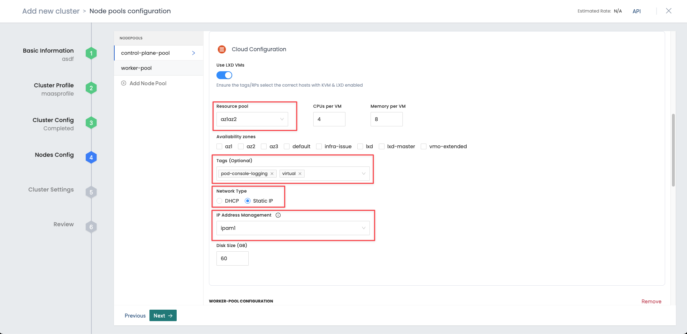

Palette supports creating and managing Kubernetes clusters deployed to a MAAS account with LXD Virtual Machines (VMs)
enabled. This feature allows you to spawn multiple control plane nodes as LXD VMs and consolidate them on MAAS-managed
servers, while your worker nodes run on bare metal. This improves resource utilization by reducing the number of bare
metal machines needed to run control planes and keeps virtualization overhead low.

## Limitations

<!-- prettier-ignore-start -->

The deployment of MAAS clusters to LXD VMs is limited to the Kubernetes distribution <VersionedLink text="Palette eXtended Kubernetes (PXK)" url="/integrations/packs/?pack=kubernetes" />.

<!-- prettier-ignore-end -->

## Prerequisites

- A [MAAS account registered in Palette](register-manage-maas-cloud-accounts.md). All MAAS-registered Palette accounts
  must use either a System Private Gateway or Private Cloud Gateway (PCG) to connect to the MAAS environment. For more
  information on which PCG to use, refer to our MAAS [Architecture](./architecture.md) guide.

  - If you want to use a static network range for the workload cluster's control plane, ensure you have configured an IP
    pool on the [IP Address Management (IPAM)](../../pcg/manage-pcg/create-manage-node-pool.md) tab of the PCG. The IP
    pool must have **Restrict to a single cluster** enabled.

  - If your Palette instance does not have a direct connection to the MAAS environment, you must manually
    [deploy a PCG cluster](../../pcg/deploy-pcg/maas.md) to your MAAS environment.
  - If you are using a self-hosted Palette or Palette VerteX instance that has a direct connection to your MAAS
    environment, you can use Palette's [System Private Gateway](../../pcg/architecture.md#system-private-gateway).

- A [cluster profile](../../../profiles/cluster-profiles/cluster-profiles.md) for the MAAS environment. The Operating
  System (OS) image used in your cluster profile must be downloaded and available in your MAAS environment. Review
  [How to use standard images](https://canonical.com/maas/docs/about-images) for guidance on downloading OS images for
  MAAS.

- MAAS hosts that support KVM or LXD VMs.

- The **LxdMaas** feature flag enabled in the
  [system console](../../../enterprise-version/system-management/feature-flags.md).

:::info

<!-- prettier-ignore-start -->

By default, Palette registers a Domain Name System (DNS) record in MAAS for the deployed cluster and links it to the IP addresses of the
control plane nodes. However, you can use the <VersionedLink text="Palette eXtended Kubernetes (PXK)" url="integrations/packs/?pack=kubernetes&tab=custom#custom-api-server-endpoint-for-maas-clusters" /> pack to configure a custom API server endpoint for your cluster instead.

<!-- prettier-ignore-end -->

:::

- If configuring the **Cert Manager** pack , ensure that you use version 1.19.1 or later. It is also important to
  ensure:
  - `crds.enabled` is set to `false`.
  - `cainjector.enabled` is set to `false` or `cainjector.replicas` is set to `0`.
  - `nodeSelector` or `nodeAffinity` is set to prevent scheduling of Cert Manager on control pane nodes.

## Deploy a MAAS Cluster with LXD-Enabled

Deploying a MAAS cluster with LXD enabled is a two-step process. First, you deploy your host cluster nodes on bare-metal
MAAS servers that have LXD enabled. Then, you deploy your workload cluster with its control plane nodes as LXD VMs that
are managed by the host cluster. The worker nodes are still deployed on bare-metal MAAS servers.

### Deploy a Host Cluster with LXD-Enabled MAAS Hosts

1.  Log in to [Palette](https://console.spectrocloud.com).

2.  Ensure you are in the correct project scope.

3.  From the left main menu, select **Clusters**, and choose either **Create Cluster** or **Add New Cluster**.

4.  In the **Data Center** section, select **MAAS**.

5.  In the bottom-right corner, click **Start MAAS Configuration**.

6.  Complete the following information. Select **Next** when finished.

    | **Field**         | **Description**                                                                                                                                                                                                                          |
    | ----------------- | ---------------------------------------------------------------------------------------------------------------------------------------------------------------------------------------------------------------------------------------- |
    | **Cluster Name**  | Enter a custom name for the cluster.                                                                                                                                                                                                     |
    | **Description**   | (Optional) Provide context about the cluster.                                                                                                                                                                                            |
    | **Tags**          | (Optional) Assign any desired cluster tags. You can use tags to filter and organize clusters in Palette. Example: `env:test`.                                                                                                            |
    | **Cloud Account** | Select the appropriate MAAS account under which to deploy the cluster. If the account is not listed, select **Add New Account**, and follow the prompts to [add your MAAS account](./register-manage-maas-cloud-accounts.md) to Palette. |

7.  <PartialsComponent category="cluster-templates" name="profile-vs-template" />

8.  <PartialsComponent category="profiles" name="cluster-profile-variables-deployment" />

9.  Fill out the following fields on the **Cluster Config** step.

    | **Field**                                      | **Description**                                                                                                                                                                                                                                                                                                                                                                                                                                                                                                                                                                |
    | ---------------------------------------------- | ------------------------------------------------------------------------------------------------------------------------------------------------------------------------------------------------------------------------------------------------------------------------------------------------------------------------------------------------------------------------------------------------------------------------------------------------------------------------------------------------------------------------------------------------------------------------------ |
    | **Domains**                                    | Register a DNS record in the selected domain for the deployed cluster. The DNS record links to the IP addresses of the control plane nodes.                                                                                                                                                                                                                                                                                                                                                                                                                                    |
    | **SSH Keys (Optional)**                        | Inject public Secure Shell (SSH) keys into `~/.ssh/authorized_keys` on each control plane and worker node, including LXD VMs, without removing existing MAAS users. The list is populated using the keys in **Tenant Settings** or **Project Settings** > **Security** > **SSH Keys**. Select **Add Item** to [add additional keys](../../cluster-management/ssh/ssh-keys.md). Refer to [SSH Keys on MAAS Cluster Nodes](architecture.md#ssh-keys-on-maas-cluster-nodes) for details on supported distributions.                                                               |
    | **NTP Servers (Optional)**                     | Specify Network Time Protocol (NTP) servers for the cluster nodes. The servers you provide override the machine image defaults. We recommend specifying at least one NTP server to prevent time drift issues. Refer to [NTP Servers on MAAS Cluster Nodes](architecture.md#ntp-servers-on-maas-cluster-nodes) for details on supported distributions.                                                                                                                                                                                                                          |
    | **Override Cluster API cluster configuration** | Enable if you want to provide custom Cluster API manifests in YAML format. This is an advanced option that allows you to customize the underlying CAPI objects used to provision and manage your cluster. When enabled, the **Update Cluster API cluster configuration** option becomes available. Click this button to view the YAML code editor drawer, where you can provide your override configuration. Review the [Override CAPI Properties](../../../architecture/override-capi-properties/override-capi-properties.md) documentation to learn more about this feature. |

10. Click the **Host LXD-Based Control Planes** toggle to use this cluster as an LXD-based control plane (hypervisor)
    for running control plane components as LXD VMs. Select **Next**.

    

11. Configure the control plane and, optionally, worker node pools.

    The following input fields apply to MAAS control plane and worker node pools. For a detailed list of input fields
    that are common across environments and their usage, refer to our
    [Node Pools](../../cluster-management/node-pool.md#node-pool-configuration-settings) guide. Select **Next** when
    finished.

    | **Parameter**                                               | **Description**                                                                                                                                                                                                                                                                                                                                                                                                                                                                                                                                                                    |
    | ----------------------------------------------------------- | ---------------------------------------------------------------------------------------------------------------------------------------------------------------------------------------------------------------------------------------------------------------------------------------------------------------------------------------------------------------------------------------------------------------------------------------------------------------------------------------------------------------------------------------------------------------------------------- |
    | **Resource pool**                                           | The MAAS resource pool from which to deploy nodes.                                                                                                                                                                                                                                                                                                                                                                                                                                                                                                                                 |
    | **Minimum CPU**                                             | Only select machines from the **Resource pool** that have at least the specified amount of CPU.                                                                                                                                                                                                                                                                                                                                                                                                                                                                                    |
    | **Minimum Memory**                                          | Only select machines from the **Resource pool** that have at least the specified amount of memory.                                                                                                                                                                                                                                                                                                                                                                                                                                                                                 |
    | **Availability zones**                                      | The MAAS zones in which to deploy nodes. Palette distributes nodes across the selected zones for high availability.                                                                                                                                                                                                                                                                                                                                                                                                                                                                |
    | **Override Cluster API node pool configuration (Optional)** | Enable if you want to provide custom Cluster API manifests in YAML format. This is an advanced option that allows you to customize the underlying CAPI objects used to provision and manage your node pool. When enabled, the **Update Cluster API node pool configuration** option becomes available. Click this button to view the YAML code editor drawer, where you can provide your override configuration. Review the [Override CAPI Properties](../../../architecture/override-capi-properties/override-capi-properties.md) documentation to learn more about this feature. |
    | **Tags**                                                    | Controls which MAAS machines to use for the node pool based on [MAAS tags](https://canonical.com/maas/docs/about-machine-groups#p-22953-tags). If you specify multiple tags, Palette only selects machines that have _all_ of the specified tags. <br /> <br /> **WARNING:** Modifying tags on an existing node pool triggers a node repave.                                                                                                                                                                                                                                       |

12. <PartialsComponent category="clusters" name="cluster-settings" />

13. Select **Validate** to review your cluster configurations and settings.

14. If no changes are needed, select **Finish Configuration** to deploy your cluster.

To monitor the status of your cluster deployment, from the left main menu, select **Clusters** and choose your cluster.
The cluster **Overview** tab displays the status and health of your cluster, as well as deployment details. Use the
**Events** tab to monitor the deployment in real time. Provisioning may take several minutes.

### Deploy a Workload Cluster with LXD VMs as Control Plane Nodes

1.  Log in to [Palette](https://console.spectrocloud.com).

2.  Ensure you are in the correct project scope.

3.  From the left main menu, select **Clusters**, and choose either **Create Cluster** or **Add New Cluster**.

4.  In the **Data Center** section, select **MAAS**.

5.  In the bottom-right corner, click **Start MAAS Configuration**.

6.  Enter the basic information for your cluster, including the **Cluster name**, **Description**, and **Tags**.

7.  From the **Cloud Account** drop-down menu, select your MAAS cloud account, and click **Next**.

8.  <PartialsComponent category="cluster-templates" name="profile-vs-template" />

    #### Additional Configurations

    - To use two subnets, add the `cloud.maas.lxdVMSubnets` configuration to the Kubernetes layer of your cluster
      profile. The first subnet must specify the preboot execution environment (PXE), used for the initial booting and
      provisioning of LXD virtual machines, and the second must specify the subnet used to configure static IPs for
      workload traffic.

           ```yaml title="Example LXD subnet configuration" hideClipboard
           cloud:
             maas:
               lxdVMSubnets: 10.11.160.0/24,10.10.128.0/18
           ```

9.  <PartialsComponent category="profiles" name="cluster-profile-variables-deployment" />

10. Fill out the following fields on the **Cluster Config** step.

    | **Field**                                      | **Description**                                                                                                                                                                                                                                                                                                                                                                                                                                                                                                                                                                |
    | ---------------------------------------------- | ------------------------------------------------------------------------------------------------------------------------------------------------------------------------------------------------------------------------------------------------------------------------------------------------------------------------------------------------------------------------------------------------------------------------------------------------------------------------------------------------------------------------------------------------------------------------------ |
    | **Domains**                                    | Register a DNS record in the selected domain for the deployed cluster. The DNS record links to the IP addresses of the control plane nodes.                                                                                                                                                                                                                                                                                                                                                                                                                                    |
    | **SSH Keys (Optional)**                        | Inject public Secure Shell (SSH) keys into `~/.ssh/authorized_keys` on each control plane and worker node, including LXD VMs, without removing existing MAAS users. The list is populated using the keys in **Tenant Settings** or **Project Settings** > **Security** > **SSH Keys**. Select **Add Item** to [add additional keys](../../cluster-management/ssh/ssh-keys.md). Refer to [SSH Keys on MAAS Cluster Nodes](architecture.md#ssh-keys-on-maas-cluster-nodes) for details on supported distributions.                                                               |
    | **NTP Servers (Optional)**                     | Specify Network Time Protocol (NTP) servers for the cluster nodes. The servers you provide override the machine image defaults. We recommend specifying at least one NTP server to prevent time drift issues. Refer to [NTP Servers on MAAS Cluster Nodes](architecture.md#ntp-servers-on-maas-cluster-nodes) for details on supported distributions.                                                                                                                                                                                                                          |
    | **Override Cluster API cluster configuration** | Enable if you want to provide custom Cluster API manifests in YAML format. This is an advanced option that allows you to customize the underlying CAPI objects used to provision and manage your cluster. When enabled, the **Update Cluster API cluster configuration** option becomes available. Click this button to view the YAML code editor drawer, where you can provide your override configuration. Review the [Override CAPI Properties](../../../architecture/override-capi-properties/override-capi-properties.md) documentation to learn more about this feature. |

11. When creating a workload cluster that will leverage MAAS LXD or will use an existing host LXD-based control plane,
    leave the **Host LXD-Based Control Planes** option disabled. Select **Next**.

    

12. Configure the control plane and worker node pools. The following input fields apply to MAAS node pools. For a
    detailed list of input fields that are common across environments and their usage, refer to our
    [Node Pools](../../cluster-management/node-pool.md#node-pool-configuration-settings) guide. Select **Next** when
    finished.

    #### Cloud Configuration

    | **Parameter**                                               | **Description**                                                                                                                                                                                                                                                                                                                                                                                                                                                                                                                                                                    |
    | ----------------------------------------------------------- | ---------------------------------------------------------------------------------------------------------------------------------------------------------------------------------------------------------------------------------------------------------------------------------------------------------------------------------------------------------------------------------------------------------------------------------------------------------------------------------------------------------------------------------------------------------------------------------- |
    | **Use LXD VMs**                                             | Select this option to deploy the workload cluster's control plane nodes as LXD VMs instead of on bare metal MAAS servers. This option is only displayed if you have KVM or LXD enabled on MAAS and you did _not_ select **Host LXD-Based Control Planes** in step 11.                                                                                                                                                                                                                                                                                                              |
    | **Resource pool**                                           | The MAAS resource pool from which to deploy nodes.                                                                                                                                                                                                                                                                                                                                                                                                                                                                                                                                 |
    | **Minimum CPU**                                             | Only select machines from the **Resource pool** that have at least the specified amount of CPU.                                                                                                                                                                                                                                                                                                                                                                                                                                                                                    |
    | **Minimum Memory**                                          | Only select machines from the **Resource pool** that have at least the specified amount of memory.                                                                                                                                                                                                                                                                                                                                                                                                                                                                                 |
    | **Availability zones**                                      | The MAAS zones in which to deploy nodes. Palette distributes nodes across the selected zones for high availability. These must match the same zones used by the hosted LXD-based control plane.                                                                                                                                                                                                                                                                                                                                                                                    |
    | **Override Cluster API node pool configuration (Optional)** | Enable if you want to provide custom Cluster API manifests in YAML format. This is an advanced option that allows you to customize the underlying CAPI objects used to provision and manage your node pool. When enabled, the **Update Cluster API node pool configuration** option becomes available. Click this button to view the YAML code editor drawer, where you can provide your override configuration. Review the [Override CAPI Properties](../../../architecture/override-capi-properties/override-capi-properties.md) documentation to learn more about this feature. |
    | **Tags**                                                    | Control which MAAS machines to use for the node pool based on [MAAS tags](https://canonical.com/maas/docs/about-machine-groups#p-22953-tags). If you specify multiple tags, Palette only selects machines that have _all_ of the specified tags. If you are using a hosted LXD-based control plane, the resource pool, availability zones, and tags must also match. <br /> <br /> **WARNING:** Modifying tags on an existing node pool triggers a node repave.                                                                                                                    |
    | **Network Type**                                            | (Control plane pools only) Select **MAAS Automatic** or **Palette Static IP Pool**. For **Palette Static IP Pool**, select the **IP Address Management** drop-down and choose the desired [IPAM node pool](../../pcg/manage-pcg/create-manage-node-pool.md). The IP pool must have **Restrict to a single cluster** enabled. This option is only available when **Use LXD VMs** is enabled for the control plane pool.                                                                                                                                                             |

    :::danger

    Ensure that your **Resource pool**, **Availability zones**, and **Tags** selections match the same values used for
    the host cluster nodes. Failure to do so may result in LXD VMs created on MAAS hosts that do not have LXD
    initialized, which can lead to cluster provisioning failures.

    :::

    

13. <PartialsComponent category="clusters" name="cluster-settings" />

14. Select **Validate** to review your cluster configurations and settings.

15. If no changes are needed, select **Finish Configuration** to deploy your cluster.

To monitor the status of your cluster deployment, from the left main menu, select **Clusters** and choose your cluster.
The cluster **Overview** tab displays the status and health of your cluster, as well as deployment details. Use the
**Events** tab to monitor the deployment in real time. Provisioning may take several minutes.

## Validate

Use the following steps to You can validate your cluster is up and in **Running** state.

1. Log in to [Palette](https://console.spectrocloud.com).

2. Ensure you are in the correct project scope.

3. From the left main menu, select **Clusters**. The **Clusters** page displays a list of all available clusters that
   Palette manages.

4. Select the cluster you deployed. On the **Overview** tab, ensure the **Cluster Status** is **Running** and that the
   cluster has a **Health** status of **Healthy**.

## Update a MAAS Cluster

:::warning

Ensure that the OS image used in your cluster profile is downloaded and available in your MAAS environment before
attempting to update your cluster. Review [How to use standard images](https://canonical.com/maas/docs/about-images) for
guidance on downloading compatible OS images for MAAS.

:::

Updates can include changes to the cluster configuration, such as a Kubernetes upgrade, or a node configuration, such as
changing the CPU or memory requirements, or picking a different availability zone. These updates are orchestrated using
a rolling repave of the cluster nodes. To learn more about managing a MAAS cluster, refer to
[Manage Clusters](../../cluster-management/cluster-updates.md).

Updating the host cluster causes a rolling repave across nodes. During the repave, nodes running older versions are
removed, and the associated LXD VMs are deleted. If the leader node is deleted, the control plane components of the
workload cluster undergo a new leader election process and choose a new leader on an LXD VM running on a different node.
For this reason, it is _critical_ that the host and workload clusters are configured for high availability, consisting
of at least three nodes per cluster, with the nodes spread across different availability zones.

Workload cluster updates function the same as regular MAAS clusters. Instead of provisioning new bare-metal hosts, new
LXD VMs are created for the control plane nodes.

To protect your data, we recommend creating a backup of your MAAS cluster before proceeding with any updates or
infrastructure changes. Review our [Backup and Restore](../../cluster-management/backup-restore/backup-restore.md) guide
for additional information.

## Manage LXD Host Maintenance

When you need to service an LXD host, such as applying firmware updates, replacing hardware, or rebooting the machine,
you can place the host into maintenance so that Palette stops scheduling new LXD VMs on it. Palette controls this
behavior through MAAS tags that you apply to the host machine in MAAS. The Cluster API provider for MAAS reads these
tags when it selects a host for a new control plane LXD VM, and skips any host that is under maintenance.

You apply these tags to the LXD _host_ machine in MAAS, not to a cluster or node pool in Palette. Palette-managed LXD
hosts follow the `lxd-host-<name>` naming convention in MAAS, which helps you identify the correct machine. For more
information about MAAS tags, review the [MAAS tags](https://canonical.com/maas/docs/about-machine-groups#p-22953-tags)
documentation.

### Host Maintenance Tags

The following tags control the maintenance state of an LXD host.

| **Tag**                     | **Purpose**                                                                        | **When to Apply**                                                                                     |
| --------------------------- | ---------------------------------------------------------------------------------- | ----------------------------------------------------------------------------------------------------- |
| `maas-lxd-host-noschedule`  | Cordons the host so that Palette does not place new LXD VMs on it.                 | Apply when you want to stop new control plane VMs from being scheduled on the host.                   |
| `maas-lxd-host-maintenance` | Marks the host as a drain source so that Palette evacuates its control plane VMs.  | Apply together with the other two tags when you want to move existing control plane VMs off the host. |
| `maas-lxd-hcp-op-<id>`      | Identifies a single maintenance operation, where `<id>` is a unique value you set. | Apply together with the other two tags to start a full maintenance operation.                         |

:::info

A host is excluded from new LXD VM placement when it carries either the `maas-lxd-host-noschedule` tag or the
`maas-lxd-host-maintenance` tag. The control plane VMs that are already running on the host continue to run until you
start a full maintenance operation.

:::

### Cordon a Host

Cordon a host when you want to prevent new LXD VMs from landing on it while leaving the control plane VMs that are
already running on the host in place. This is the recommended first step before you service a host.

<Tabs groupId="cordon-host">

<TabItem label="MAAS UI" value="maas-ui">

1. Log in to the MAAS web console.

2. From the left main menu, select **Machines**.

3. Select the LXD host you want to cordon. Palette-managed hosts use the `lxd-host-<name>` naming convention.

4. Select the **Configuration** tab.

5. In the **Tags** section, select **Edit**.

6. Enter `maas-lxd-host-noschedule` in the tag field. If the tag does not exist yet, select the option to create it.

7. Select **Save** to apply the tag to the host.

</TabItem>

<TabItem label="MAAS CLI" value="maas-cli">

1. Log in to MAAS. Replace the profile name, MAAS URL, and API key with your own values. You can find your API key in
   the MAAS console under your user preferences.

   ```bash
   maas login admin http://<maas-host>:5240/MAAS <api-key>
   ```

2. Create the cordon tag in the MAAS inventory. This command succeeds even if the tag already exists.

   ```bash
   maas admin tags create name=maas-lxd-host-noschedule comment="Block new LXD VM placement"
   ```

3. Identify the system ID of the LXD host you want to cordon.

   ```bash
   maas admin machines read | jq -r '.[] | select(.hostname | startswith("lxd-host-")) | "\(.hostname) \(.system_id)"'
   ```

4. Apply the tag to the host. Replace `<system-id>` with the value from the previous step.

   ```bash
   maas admin tag update-nodes maas-lxd-host-noschedule add=<system-id>
   ```

5. Verify that the tag is assigned to the host.

   ```bash
   maas admin machine read <system-id> | jq '.tag_names'
   ```

</TabItem>

</Tabs>

After you cordon the host, Palette no longer schedules new LXD VMs on it. To resume scheduling, follow the steps in
[Lift Host Maintenance](#lift-host-maintenance).

### Place a Host Under Full Maintenance

Full maintenance cordons the host _and_ evacuates the control plane LXD VMs that are already running on it. Palette
moves each control plane VM to another eligible host so that you can safely take the host offline.

:::warning

Before you start a full maintenance operation, ensure that the affected host and workload clusters are configured for
high availability, with at least three nodes per cluster spread across different availability zones. Evacuating control
plane VMs from a cluster that is not highly available can disrupt the control plane.

:::

To start a full maintenance operation, apply all three of the following tags to the host:

- `maas-lxd-host-noschedule`
- `maas-lxd-host-maintenance`
- `maas-lxd-hcp-op-<id>`, where `<id>` is a unique identifier for the operation, such as a Universally Unique Identifier
  (UUID).

The following example uses the MAAS CLI to apply all three tags. Use the same login and host identification steps
described in [Cordon a Host](#cordon-a-host).

```bash
# Generate a unique operation ID.
OP_ID=$(uuidgen | tr '[:upper:]' '[:lower:]')

# Create the maintenance tags in the MAAS inventory.
maas admin tags create name=maas-lxd-host-maintenance comment="Drain LXD VMs from host"
maas admin tags create name=maas-lxd-hcp-op-${OP_ID} comment="Maintenance operation ${OP_ID}"

# Apply all three tags to the host. Replace <system-id> with your host system ID.
maas admin tag update-nodes maas-lxd-host-noschedule add=<system-id>
maas admin tag update-nodes maas-lxd-host-maintenance add=<system-id>
maas admin tag update-nodes maas-lxd-hcp-op-${OP_ID} add=<system-id>
```

:::warning

Enter the tag names exactly as shown. Palette matches these tag names literally, so a typo prevents the host from
entering maintenance.

:::

After you apply the tags, Palette detects the maintenance state and begins evacuating the control plane VMs from the
host. Monitor the affected clusters from the **Clusters** page in Palette to confirm that new control plane VMs come up
on other hosts and that each cluster remains healthy before you take the host offline.

### Lift Host Maintenance

When you finish servicing the host, remove the maintenance tags to return the host to the pool of eligible hosts.
Palette resumes scheduling new LXD VMs on the host after you remove the tags.

<Tabs groupId="lift-maintenance">

<TabItem label="MAAS UI" value="maas-ui">

1. Log in to the MAAS web console.

2. From the left main menu, select **Machines**.

3. Select the LXD host that is under maintenance.

4. Select the **Configuration** tab.

5. In the **Tags** section, select **Edit**.

6. Remove the maintenance tags that are assigned to the host, and then select **Save**.

</TabItem>

<TabItem label="MAAS CLI" value="maas-cli">

1. Remove the maintenance tags from the host. Replace `<system-id>` and `<id>` with your own values. Omit the tags that
   you did not apply.

   ```bash
   maas admin tag update-nodes maas-lxd-host-noschedule remove=<system-id>
   maas admin tag update-nodes maas-lxd-host-maintenance remove=<system-id>
   maas admin tag update-nodes maas-lxd-hcp-op-<id> remove=<system-id>
   ```

2. Verify that the maintenance tags are no longer assigned to the host.

   ```bash
   maas admin machine read <system-id> | jq '.tag_names'
   ```

</TabItem>

</Tabs>

## Delete a MAAS Cluster

:::warning

Before deleting a MAAS LXD cluster, consider the following:

- If the _host cluster_ currently runs LXD control planes for any workload clusters, you must first move the workload
  clusters to a different host cluster. Deleting a host cluster that hosts control planes will bring the workload
  clusters down. Once the host cluster is removed, or if the host cluster is not running on any LXD VMs, you can delete
  it the same way as regular MAAS clusters.

- _Workload clusters_ can be deleted the same way as regular MAAS clusters. Deleting a workload cluster that uses LXD
  will also delete the LXD VMs created for that workload cluster on the host cluster.

:::

Take the following steps to delete a MAAS cluster. Note that when you delete a MAAS cluster, all machines and associated
storage disks that were created for the cluster are removed.

1. Log in to [Palette](https://console.spectrocloud.com) as a tenant admin.

2. From the left main menu, select **Clusters**.

3. Select the cluster you want to delete.

4. In the top-right, select the **Settings** drop-down menu, and choose **Delete**.

The cluster status is updated to **Deleting** while cluster resources are being deleted. When all resources are
successfully deleted, the cluster status is updated to **Deleted** and the cluster is removed from the list. The delete
operation returns the hosts to the **Ready** state. All the artifacts related to the Kubernetes distribution are
removed.

## Next Steps

Now that you have deployed a MAAS cluster, you can start developing and deploying applications to your cluster. We
recommend you review the Day-2 operations and become familiar with the cluster management tasks. Check out the
[Manage Clusters](../../cluster-management/cluster-management.md) documentation to learn more about Day-2
responsibilities.
